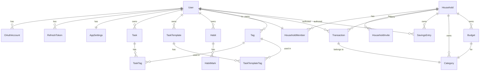

# ARCHITECTURE.md — MyDay

Справочник по архитектурным решениям, связям в БД и зонам риска. Правила работы и повседневные конвенции — в `CLAUDE.md`. Открывай этот файл при работе с БД, security-логикой или перед рефакторингом, задевающим что-то из списка ниже.

---

## Архитектура БД

### Ключевые решения

| Решение | Почему |
|---------|--------|
| Hard delete везде | Проект личный, нет нужды в восстановлении удалённых данных |
| `Decimal(12,2)` для денег | Float накапливает ошибки (`0.1 + 0.2 ≠ 0.3`) при агрегации |
| `date` + `createdAt` в Transaction | `date` — когда произошла транзакция (user sets), `createdAt` — когда создана запись. Фильтрация по месяцу всегда по `date` |
| Категории per-user, сидируются при регистрации | Нет nullable userId, каждый владеет своими категориями, может удалять любые |
| Tags — отдельная таблица many-to-many | Тег — сущность: можно переименовать, добавить цвет, считать статистику. `Tag.color` nullable — до появления UI цвета старые теги не ломаются |
| `SavingsEntry` отдельно от `Transaction` | Накопительный счёт не пересекается с основными финансами. Отдельная таблица = чистые запросы. `SavingsEntry` имеет `type: SavingsType (DEPOSIT \| WITHDRAWAL \| OPENING)` и всегда положительный `amount`. Баланс = `OPENING + SUM(DEPOSIT) - SUM(WITHDRAWAL)`. Это позволяет и пополнять, и снимать с накоплений |
| Баланс накоплений — всегда total, не по месяцу | Накопления накопительные по природе: если отложил 10к в январе и 5к в феврале — итого 15к, а не 5к. Фильтр по месяцу применяется только к истории записей, не к балансу. `GET /api/finance/savings` возвращает `{ balance, delta, opening, entries }` где `balance` = SUM за всё время |
| `OPENING` — стартовый остаток, не пополнение (08.10.2026) | Деньги, которые уже были до начала учёта. Входят в `balance`, но не в `delta`: `delta = SUM(DEPOSIT) - SUM(WITHDRAWAL)` за период, без периода — за всё время. Иначе первый ввод 245к становился «+245к», и бейдж оставался в плюсе, даже когда с этих денег только снимали. Один на пользователя (второй — 409); сумму и заметку можно поправить через `PATCH`, тип записи не меняется. `opening: null` в ответе — признак «ещё не задан», по нему UI показывает ссылку «Указать стартовый остаток» |
| `RefreshToken` в БД с bcrypt-хешем | Инвалидация токенов при logout/смене пароля. Хеш — если БД утечёт, сырые токены не скомпрометированы |
| `shared/` для типов и Zod | Единственный способ шарить код между client и server в Nuxt без хаков |
| Агрегация finance на сервере | SQL SUM/GROUP BY быстрее чем JS reduce на 500 записях |
| PIN — UI lock, не второй фактор | Пользователь аутентифицирован, PIN только блокирует интерфейс. Хеш в `AppSettings` и **клиенту не отдаётся**: bcrypt-хеш четырёхзначного кода перебирается офлайн за секунды. Проверка — `POST /api/settings/pin/verify` с лимитом на неудачные попытки. Сброс — через провайдера регистрации (Google re-auth или пароль аккаунта). Подробности — раздел «PIN-блокировка» ниже |
| `SavingsEntry` без поля `date` | Копилке важно движение средств, а не точная дата события — бэкдейт не поддерживаем (осознанно). История сортируется по `createdAt`. Следствие (2.23): период истории и delta считаются по `createdAt` — это настоящий timestamp, а не `@db.Date`, поэтому границы берутся по UTC: `createdAt >= from 00:00Z` и `< to + 1 день 00:00Z`. У пользователя в UTC+3 запись, созданная в 01:00 первого числа, попадёт в предыдущий месяц. Мириться с этим дешевле, чем заводить у копилки собственную календарную дату ради нескольких пограничных часов |
| Таймзоны: сервер TZ-agnostic | «Сегодня» и границы месяца определяет клиент в своей таймзоне и передаёт `from`/`to` в query. Сервер не делает дата-математику от собственного `new Date()` — у москвича и нью-йоркца «сегодня» разное |
| Календарная дата на проводе — всегда `YYYY-MM-DD` (решение 10.09.2026, распространено на `Task.dueDate` 14.09.2026) | `Transaction.date`, `Budget.month` и `Task.dueDate` — `@db.Date`, то есть календарный день без времени. Поэтому и в query (`from`/`to`), и в body (`date`) ходит date-only строка, посчитанная клиентом в его таймзоне (`toDateString()` в `app/utils/formatDate.ts`). Полный ISO datetime отвергается схемой с 400. Почему: `new Date().toISOString()` отдаёт UTC-мгновение, и Postgres обрезал его до UTC-дня — в UTC−7 любая вечерняя транзакция уезжала на следующий день, а 31-го числа — в следующий месяц. Обратная сторона того же правила: date-only значение нельзя читать через локальные геттеры `new Date(...)` — форматтеры в `app/utils/formatDate.ts` разбирают такую строку как календарную дату, группировка по дням берёт ключ через `toDayKey` (срез строки, а не локальные геттеры) |
| Удаление категории → переназначение на «Другое» (решение 28.07.2026) | Каждому пользователю сидируются две системные категории «Другое» (EXPENSE и INCOME) с флагом `isSystem` — их нельзя удалить и сменить тип. При удалении обычной категории её транзакции переназначаются на «Другое» того же типа, бюджеты категории удаляются — всё в одной `$transaction`. История и итоги прошлых месяцев не меняются. Альтернатива (каскад) отвергнута: удаление категории — операция над таксономией, а не над финансовой историей. Реализовано в **4.5.0** |
| Тип транзакции и тип категории обязаны совпадать (решение 11.09.2026) | `Transaction.type` и `Category.type` — независимые поля, FK их не связывает, и EXPENSE под «Salary» молча искажал бы breakdown и итоги. Проверяется в хендлере (400): POST сверяет пару, PATCH — *итоговую* пару после применения патча, поэтому сменить тип транзакции можно только вместе с категорией. В UI это уже так: сетка категорий фильтруется по типу (DESIGN.md → TransactionEditSheet) |
| Summary и список транзакций делят один фильтр-контракт (решение 11.09.2026) | `GET /api/finance/summary` принимает те же `from`/`to`/`type`/`categoryIds`/`search`, что и `GET /api/finance/transactions`: схема `transactionFilterQuerySchema` (список = она же плюс `page`/`limit`) и один построитель WHERE — `server/utils/transactionWhere.ts`. Иначе hero и breakdown считались бы по одному набору, а список под ними — по другому. `breakdown` следует за фильтром типа (пересмотрено 08.10.2026): при `type=INCOME` — разбивка **доходов**, иначе — **расходов** («Spend by category»). Тип отдаётся полем `breakdownType`: по нему вёрстка берёт базу для процентов (`income`/`expense`) и заголовок, а `dropFromSummary` патчит breakdown только транзакцией того же типа. Раньше при `type=INCOME` breakdown был пустым, и таб «Доходы» показывал ложное «Нет данных за этот период». Тот же эндпоинт закрывает `ResultSummary` в All Transactions (2.21) |
| Ответ 404 на чужой или отсутствующий ресурс (решение 11.09.2026) | Одиночные `PATCH`/`DELETE` ограничены `where: { id, userId }`, поэтому чужая запись и несуществующая неотличимы — обе дают Prisma P2025, и обе должны отдавать 404, а не 500 и не 403: по коду ответа нельзя узнать, существует ли чужой id. Маппинг — `orNotFound`/`orConflict` в `server/utils/dbError.ts`, один идиом на все ресурсы |
| Названия сидовых категорий локализуются через `key`, а не переводом строк в БД (решение 11.09.2026) | Категории — данные пользователя (их переименовывают), поэтому в БД лежит `name`, и сидовые приходили только на английском. Решение: у сидовых категорий будет `Category.key` (`food`, `transport`, …), и UI показывает `t('categories.<key>')`; как только пользователь меняет `name`, `key` обнуляется и дальше показывается его текст. Так переключение языка переводит нетронутые категории, а свои и переименованные остаются как есть. Отвергнуто: сеять на языке регистрации (существующие строки и смена языка не чинятся) и хранить пару `nameEn`/`nameRu` (не работает для пользовательских категорий). Реализовано в **4.5.0** одной миграцией с `isSystem` |
| Soft delete с корзиной на 30 дней вместо жёсткого удаления (решение 09.10.2026) | `Task`, `Transaction` и `SavingsEntry` удаляются проставлением `deletedAt`. Это закрывает сразу две задачи: «Отменить» в тосте — обычный `POST …/:id/restore`, а случайный свайп можно откатить и через месяц из «Недавно удалённых». Отвергнуто: откладывать `DELETE` на клиенте на 5 секунд — любой рефетч в это окно возвращал бы ещё не удалённую строку в список, а выгруженная iOS PWA не отправила бы запрос вовсе. Теги, шаблоны и категории удаляются жёстко: тег — метка, шаблон дешевле пересоздать, у категорий свой перенос транзакций. Подробности — «Корзина и undo» ниже |
| Семья — общие финансы через `Household` (решение 09.10.2026) | Каждый пользователь всегда состоит в семье, хотя бы из одного себя: финансовые данные принадлежат семье (`householdId`), а `userId` у транзакций и записей копилки — автор. Так в коде нет веток «один / с семьёй», меняется только ключ scope. Общие всегда: транзакции и категории (бюджеты — вслед за категориями). Копилка — по флагу `Household.shareSavings` (по умолчанию общая). Задачи, шаблоны и теги остаются личными: теги пока есть только у задач, и семейные теги дали бы партнёру переименовать или удалить метку на чужой задаче. Для тегов на транзакциях (8.8) — свой семейный набор. Отвергнуто: делиться через `userId IN (участники)` — `categoryId` транзакции указывал бы в чужие категории, и проверка relation-id размывается; полная настройка «чем делиться» по каждой сущности — транзакции сцеплены с категориями и тегами, а смена настройки задним числом требует их склейки. Подробности — «Семья» ниже |
| Офлайн-запись: клиентский `id` вместо таблицы `Idempotency-Key` (решение 14.10.2026) | Повтор офлайн-записи не должен задваивать трату, когда «запрос дошёл, а ответ потерялся». Клиент сам генерирует `id` транзакции (`newClientId()`, 32 hex), и первичный ключ становится ключом идемпотентности: повторный `POST` с тем же `id` отдаёт уже созданную запись, гонку разруливает PK. Отвергнуто: таблица `IdempotencyKey` с сохранёнными ответами — миграция, чистка по сроку и лишний механизм ради одного эндпоинта создания. Подробности — «Офлайн-запись» ниже |
| Валюта — одна на семью, без конвертации (решение 25.10.2026) | `Household.currency` (ISO-код из `shared/currency.ts`, по умолчанию `RUB`) задаёт только знак при отображении: суммы в БД — просто числа, смена валюты их не пересчитывает, и все агрегации остаются как были. Колонки `currency` на `Transaction`/`SavingsEntry` нет сознательно: пока валюта у всех записей семьи одна, её можно восстановить из `Household` в любой момент, и будущая мультивалютность получит её одной миграцией без потерь. Меняет валюту только владелец. Клиент берёт её из профиля (`UserProfile.currency`), а не из запроса семьи: профиль запоминается для офлайн-сессии, а `UiMoney` в каждой строке не заводит свой `useQuery`. Отвергнуто: валюта на каждой записи уже сейчас — дубль, который надо держать в согласии с семьёй, а сводка всё равно сложила бы разные валюты |
| Budgets и Notifications — отложены до v2 (решение 28.07.2026) | MVP = Tasks + Finance (транзакции, периоды, фильтры, savings). Дата-слой бюджетов (модель, API, хуки) уже существует — не удалять и не ломать; таб Budgets скрыт из UiPillSelect. План v2 — Фаза 7 (см. `ROADMAP.md`) |

### Диаграмма связей



### Auth Flow

```mermaid
sequenceDiagram
    participant C as Client
    participant S as Server
    participant DB as Database
    participant G as Google

    Note over C,G: Email/Password регистрация
    C->>S: POST /api/auth/register {name, email, password}
    S->>S: Zod validation
    S->>DB: Create User + AppSettings + seed Categories
    S->>DB: Create RefreshToken (hashed)
    S-->>C: {accessToken} + Set-Cookie: refreshToken (httpOnly)

    Note over C,G: Google OAuth
    C->>S: GET /api/auth/oauth/google
    S-->>C: redirect → Google consent
    C->>G: user consents
    G-->>S: GET /callback?code=xxx
    S->>G: exchange code → tokens + profile
    S->>DB: Upsert User + OAuthAccount
    S-->>C: {accessToken} + Set-Cookie: refreshToken

    Note over C,S: Защищённый запрос
    C->>S: GET /api/tasks + Authorization: Bearer <accessToken>
    S->>S: middleware/01.auth.ts verifies JWT
    S-->>C: tasks data

    Note over C,S: Token refresh (автоматически при 401)
    C->>S: POST /api/auth/refresh (cookie отправляется браузером)
    S->>DB: find RefreshToken by hash, check expiresAt
    S->>DB: rotate — delete old, create new
    S-->>C: {accessToken} + новый refreshToken cookie

    Note over C,S: Logout
    C->>S: POST /api/auth/logout
    S->>DB: delete RefreshToken
    S-->>C: Set-Cookie: refreshToken=; Max-Age=0
```

### Зоны риска — нельзя менять без рефакторинга

| Решение | Что сломается при изменении |
|---------|----------------------------|
| `Decimal` для `amount` | Все агрегации, сравнения, отображение |
| `date` поле в Transaction | Вся фильтрация по месяцу/периоду |
| `userId` в каждом WHERE задач, шаблонов и тегов, `householdId` — финансов, `savingsScope()` — копилки | Утечка данных между пользователями и семьями (security) |
| `shared/` для типов и схем | Дублирование валидации или импорт-хаки |
| httpOnly cookie для refreshToken | XSS-уязвимость если переехать в localStorage |
| Категории семьи (сид при регистрации в новую семью) | Data migration + изменение всех запросов |
| `SavingsEntry` отдельно от `Transaction` | Data migration если объединить |
| `deletedAt: null` во всех чтениях и `PATCH` у `Task`, `Transaction`, `SavingsEntry` | Удалённое всплывёт в списках, `summary`, балансе копилки, и его можно будет отредактировать из корзины. Для транзакций фильтр живёт в `transactionWhere`, у копилки — в обоих `groupBy` и в проверке единственного `OPENING` |
| Нумерация middleware (`01.auth.ts`) | Порядок выполнения в Nitro |
| `requestPath()` в `01.auth.ts` и `02.rateLimit.ts` | Middleware обязан видеть тот же путь, что роутер. `getRequestURL().pathname` — сырой URL: `/%61pi/tasks` проходил без токена и отдавал задачи всех пользователей — см. «Защита API» |
| Бросающий геттер `event.context.userId` в `01.auth.ts` | Без него любая новая ошибка в сопоставлении путей снова даст хендлеру `userId: undefined`, а Prisma с `undefined` в `where` снимает фильтр |
| Последний адрес `X-Forwarded-For` в `clientIp()` | Первый адрес пишет клиент: подставляя каждый раз новый, он перебирает пароль без лимита |
| Мажорная версия в теге `pg-backup:16-…` совпадает с `db` | `pg_dump` старше сервера отказывается снимать дамп: после апгрейда `db` каждую ночь будет приходить `/fail`, пока не поднят тег образа бэкапа. Тег и дайджест меняются вместе |
| `POSTGRES_DB=myday` | Образ берёт из `PGDATABASE` хост снимков в restic и имя дампа. Если сменить имя базы, `restore` перестанет видеть снимки на Drive, тогда нужно задать сервису `BACKUP_NAME: myday` |
| Хук `close` в `nuxt.config.ts` | `nuxt build` перестанет завершаться — см. «Известные баги» |
| `clearApiCache()` в `authStore.logout()` и сброс в `plugins/session.client.ts` | Данные прошлого пользователя останутся в кэше service worker или в памяти TanStack Query и достанутся следующему — см. ниже |
| `pages/settings/index.vue`, а не `pages/settings.vue` | Файл-страница рядом с одноимённой папкой становится вложенным роут-родителем: без `<NuxtPage />` внутри дочерние страницы не рендерятся, а URL при этом меняется |
| Уникальный индекс `[userId, name, type]` у `Category` | Вернёшь `[userId, name]` — вторая системная «Другое» (INCOME) перестанет ложиться при регистрации |
| Общий промис `refreshing` и `withRefreshLock()` в `authStore.refresh()` | `init()`, `renew()`, другая вкладка и service worker могут звать refresh одновременно; второй запрос ротирует уже удалённую строку, и сессия умирает |
| `renew()` пробрасывает обрыв сети, а сессию чистит только на ответе сервера | Вернёшь «любая ошибка — выход» — на плохой сети приложение выкидывает на welcome, а офлайн-запись теряется вместе с сессией |
| `isAuthenticated = !!accessToken \|\| !!user` | Офлайн-сессия (профиль без токена) перестанет пускать на защищённые маршруты, и холодный старт без сети снова уведёт на welcome |
| `networkMode: 'always'` у `useAddTransactionMutation` | TanStack ставит мутацию на паузу, как только увидел `offline`: `mutationFn` не запустится, запись не встанет в очередь, шит повиснет со спиннером |
| JSON-клон в `putOutboxEntry()` | Тело из формы содержит реактивный Proxy (`tagIds.value`), IndexedDB его не клонирует (`DataCloneError`) — офлайн-запись падала с «Не удалось добавить» |
| Поиск своей записи до проверок в `POST /api/finance/transactions` | Повтор после удаления категории или тега получит 400, и клиент выбросит из очереди уже сохранённую запись с тостом «не удалось» |
| `omit({ id: true })` в `updateTransactionSchema` | `PATCH` с `id` в теле сменит первичный ключ транзакции |
| Константы в `public/sw-outbox.js` | Имя базы, стора, версии, sync-тега и лока продублированы из `app/utils/outbox.ts` и `refreshLock.ts` (SW-скрипт не собирается бандлером); разъедутся — Background Sync будет читать пустую базу или рефрешить мимо лока |
| Ранний выход и дедупликация в `authStore.init()` | `/api/auth/refresh` ротирует токен — повторный вызов ротирует ещё раз, параллельный упадёт на удалённой строке |
| `await authStore.init()` внутри `middleware/auth.ts` | Мидлвар идёт раньше `app.vue`; без ожидания жёсткая перезагрузка защищённой страницы выкидывает на `/auth/welcome` с валидной кукой |
| Порядок `:root[data-accent]` → `.light[data-accent]` в `main.css` | Селекторы равны по специфичности; поменяешь местами — светлая тема потеряет выбранный акцент |
| `themeSurfaces` в `useTheme.ts` | Дублирует `--c-bg` обеих тем для мета-тега `theme-color` — правится вместе с CSS |
| Полоса-подложка `top-full` под `UiSheet` | `ease-spring` перелетает конечную точку; уберёшь — при открытии под шитом мигает дыра до низа экрана |
| `@click.capture` в `UiSwipeRow` | Браузер шлёт `click` после свайпа; уберёшь — свайп по строке снова будет открывать шит редактирования |
| `setPointerCapture` только при `axis === 'x'` | Захват на `pointerdown` перенацеливает и совместимые mouse-события: `click` уйдёт на строку, а не на вложенную кнопку, и чекбоксы внутри строк перестанут работать |
| `prime()` в `lock.global.ts`, а не вотчер | Вотчер на профиле срабатывает позже навигации роутера — после перезагрузки заблокированное приложение остаётся открытым |
| Таймер замка на уровне модуля в `useAppLock.ts` | Вернёшь в замыкание — `unlock()` со страницы PIN заведёт свой таймер, который активность не сбрасывает: экран блокируется через 5 минут после ввода PIN посреди работы |
| Отсутствие `pinHash` в `toPublicSettings()` | Вернёшь — bcrypt-хеш четырёхзначного PIN уедет в браузер и в кэш service worker, где перебирается офлайн за секунды |
| Глобальный `auth.global.ts` вместо `middleware: 'auth'` на странице | Поштучная навеска уже дважды приводила к незащищённым страницам; новую страницу забудут пометить, и она откроется анониму |
| Защёлка `restored` в `authStore.init()` | Уберёшь — глобальный мидлвар будет слать `/api/auth/refresh` на каждую навигацию анонима |
| `viewport-fit=cover` в мета-теге viewport | Без него `env(safe-area-inset-*)` возвращает нули: `pb-safe`/`pt-safe` молча перестают работать, а `black-translucent` статус-бар заезжает на контент |
| `secure: !import.meta.dev` у refresh-куки | Вернёшь безусловный `secure: true` — на `http://<LAN-IP>` браузер молча выбросит куку, и сессия перестанет переживать перезагрузку на телефоне |
| Никаких secure-context API в dev-путях | `crypto.randomUUID`, `navigator.clipboard` и подобные отсутствуют на `http://<LAN-IP>`: вызов бросает, и если он внутри `onSuccess`, отменяются колбэки мутации |
| Сверка идентичности в `useFabAction()` | Снимешь — уходящая страница затрёт действие входящей, и FAB перестанет открывать шит после перехода по табу |
| Повтор запроса после 401 в `useApi()` | Уберёшь — приложение умирает через 15 минут: мутации падают, шиты не закрываются, тостов об успехе нет |
| 403 (не 401) на неверный PIN и пароль | Вернёшь 401 — `useApi()` примет опечатку за протухший токен, зря ротирует refresh и удвоит запросы |
| Счётчик попыток внутри `assertPin()` | Вынесешь обратно в middleware — либо успешные действия начнут тратить лимит, либо `DELETE /api/settings/pin` снова станет каналом для перебора |
| `bottom-fab` / `bottom-toast` / `pb-shell` вместо чисел | Высота таб-бара растёт на `env(safe-area-inset-bottom)`; фиксированные `bottom-[100px]` и `pb-28` загоняют FAB под бар на устройствах с вырезом |
| Случайные `uniqueEmail()` и `fakeIp()` в `tests/e2e/helpers.ts`, случайный IP в `registerUser()` интеграционных тестов | Счётчик модуля у каждого воркера Playwright свой и стартует с единицы: два воркера в одну миллисекунду регистрировали один и тот же email (P2002) и делили бакет rate limit — падала случайная спека |
| `vite.optimizeDeps.include` в `nuxt.config.ts` | Без него Vite находит `@tanstack/vue-query` и `zod` только на первом запросе холодного dev-сервера и перезагружает страницу. В E2E это рвёт отправку формы регистрации («Something went wrong»), и падает случайная спека — в CI кэш холодный всегда. Новую тяжёлую зависимость, которую грузит клиент, добавляй туда же |
| `min-w-0` + `grid-cols-2` у полей периода | Flex-элемент не сжимается меньше содержимого, а заполненный `input[type=date]` на iOS шире колонки — поля наезжают друг на друга |
| `appearance-none` в `UiDateInput` | С нативным оформлением iOS Safari игнорирует `w-full` у `input[type=date]` и добавляет свой отступ — поле вылезает за правый край формы |

### Кэши и смена аккаунта

`NetworkFirst` на `/api/*` (шаг 4.2) даёт офлайн-доступ к задачам и финансам, но Workbox формирует ключ кэша **по URL и игнорирует заголовок `Authorization`**. Для `/api/tasks` это значит, что ответ, сложенный под одним аккаунтом, будет отдан любому следующему пользователю того же браузера. Отсюда три ограничения, которые нельзя снимать по отдельности:

- `/api/auth/*` исключены из кэширования полностью — логин, refresh и logout всегда идут в сеть;
- кэшируются только GET и только ответы со статусом 200, чтобы не залипал 401;
- `authStore.logout()` вызывает `clearApiCache()` — это единственное, что реально разрывает связь между аккаунтами на общем устройстве.

Срок жизни записей — сутки, так что данные не переживают смену пользователя надолго даже без явного выхода. Выход без `logout()` (протух refresh) закрывает `plugins/session.client.ts` — см. ниже. С 9.1 `logout()` и `forget()` стирают ещё запомненный профиль офлайн-сессии (`myday:session`), а `logout()` — неотправленные офлайн-записи этого пользователя: выход требует сети, так что очередь к этому моменту уже разослана.

**Память клиента — та же дыра** (баг на проде 14.10.2026). Кэш TanStack Query живёт в памяти SPA, а выход не перезагружает страницу. При `staleTime` в 5 минут второй аккаунт, вошедший сразу после выхода первого, получал из памяти операции первого без единого запроса на сервер: сервер изоляцию держал, текло только на клиенте. Теперь `plugins/session.client.ts` следит за `authStore.user?.id` и, когда пользователь пропадает или меняется (выход, протухший refresh, «Выйти» на PIN-экране), делает `queryClient.clear()`, сбрасывает фильтры финансов и задач (в них id категорий и тегов прошлого аккаунта) и ещё раз чистит кэш service worker. Клиент берётся из `$queryClient` (провайд в `plugins/vue-query.ts`) внутри вотчера, а не при старте плагина: плагины идут по алфавиту, и `session.client` запускается раньше `vue-query`. Регрессию сторожит e2e «после выхода новый аккаунт не видит данные прошлого»; переходы в нём только внутри SPA — `page.goto` перезагрузил бы страницу и спрятал баг.

**Две вкладки** (ревью безопасности 14.10.2026). Выход в одной вкладке не трогал другие: там access-токен жил ещё до 15 минут, а потом `renew()` получал по общей куке токен уже нового аккаунта при старом `user`. Теперь `logout()` шлёт `signed-out` в `BroadcastChannel('myday-auth')` (`app/utils/authChannel.ts`), и `session.client.ts` в остальных вкладках делает `authStore.forget()` и уводит на `/auth/welcome`; отправитель к этому моменту уже разлогинен и своё сообщение игнорирует. Если в другой вкладке вошли под другим аккаунтом, `renew()` сверяет `sub` нового токена с `user.id` (`tokenSubject()`) и перечитывает профиль, а вотчер плагина видит смену пользователя и чистит кэши. Тот же вотчер чистит очередь тостов: persistent-тост «Тебя исключили из семьи» иначе переезжал к следующему аккаунту.

### Офлайн-запись

Шаг 9.1. Создать операцию можно без сети: она встаёт в очередь в IndexedDB и уходит на сервер, когда связь вернулась. Редактирование и удаление офлайн не ставятся в очередь — у них конфликты, а у создания их нет.

**Повтор не задваивает — клиентский `id`.** `useAddTransactionMutation` генерирует `id` (`newClientId()` — `crypto.getRandomValues`, потому что `randomUUID` нет на `http://<LAN-IP>`) **до первой попытки** и шлёт его в теле. Самый опасный случай — не «сети нет», а «запрос дошёл, ответ потерялся»: клиент видит обрыв и кладёт запись в очередь, а она уже создана. Сервер (`POST /api/finance/transactions`) сначала ищет свою запись с этим `id` (`householdId` + `userId`, включая корзину) и отдаёт её; иначе создаёт с этим `id`; на P2002 (гонка вкладки и service worker) ищет ещё раз, а не нашёл — 409, `id` занят чужой записью. Поиск идёт до проверки категории и тегов: повтор после удаления категории иначе получил бы 400. `id` — `[a-z0-9]{24,64}`, необязателен: старый закэшированный клиент шлёт без него. Ответ 409 выдаёт, существует ли чужой `id`, — осознанно: id случайные, перебрать их нельзя.

**Очередь** — `app/utils/outbox.ts` (база `myday-outbox`, стор `entries`, ключ — `id` транзакции, индекс по `userId`) и `useOutbox()` с модульным `pending` для UI. Мутация: если `navigator.onLine === false` — сразу в очередь; иначе `POST` с таймаутом 10 с, и только **обрыв транспорта** (`isTransportError()`: `FetchError` без статуса) кладёт запись в очередь, ответ сервера с ошибкой остаётся ошибкой. Досылка (`deliver()`) идёт по порядку: успех и отказ 4xx убирают запись (отказ — постоянным тостом «внеси заново»), обрыв, 401, 408, 429 и 5xx останавливают досылку и оставляют остаток. Записи привязаны к `userId`: чужие на общем устройстве не шлются и не показываются.

**Когда досылаем** (`plugins/outbox.client.ts`): при появлении пользователя (старт приложения — это и есть «досылка при открытии» на iOS), на `online`, на возврате во вкладку (`visibilitychange`) и из service worker по Background Sync. Параллельные вызовы делят один промис. В «лжи-фае» (сеть есть, интернета нет) `online` не приходит — запись уйдёт при следующем возврате в приложение.

**Background Sync** — `public/sw-outbox.js`, подключён через `workbox.importScripts`. После постановки в очередь страница регистрирует sync-тег `myday-outbox`; Chromium будит SW, когда сеть вернулась, даже если приложение закрыто. Токена у SW нет, поэтому он сам делает `/api/auth/refresh` под тем же Web Lock, что и страница, берёт записи пользователя из `sub` токена и шлёт их тем же телом; 4xx оставляет странице (там есть тост), обрыв и 5xx бросают — браузер повторит позже. После отправки SW шлёт окнам `outbox:synced`, и страница обновляет списки. На iOS Background Sync нет — там работает досылка при открытии.

**Refresh под замком.** `authStore.refresh()` делит один промис между `init()` и `renew()` и идёт через `withRefreshLock()` (`navigator.locks`): ротирующий refresh теперь могут позвать вкладки и service worker одновременно. Без Web Locks (`http://<LAN-IP>`) — просто запрос; SW там и не регистрируется.

**Офлайн-сессия.** Профиль последнего вошедшего лежит в `localStorage` (`myday:session`, `app/utils/sessionMemory.ts`), обновляется вотчером на `user`. Если refresh на старте не дошёл до сервера (или браузер уже знает, что офлайн), `restore()` поднимает этот профиль без токена: `isOffline`, `isAuthenticated` по-прежнему `true`. Данные идут из кэша service worker (`networkMode: 'offlineFirst'` у запросов TanStack, иначе при `offline` запросы стоят на паузе и кэш SW не читается), запись — в очередь. На `online` плагин зовёт `init()`: сервер ответил «сессии нет» — профиль забывается и пользователь уходит на welcome. Профиль стирается на `logout()`, `forget()` и любом ответе сервера «сессии нет». Без запомненного профиля холодный старт без сети по-прежнему ведёт на welcome.

**Что показываем.** Тост «Сохранено без сети» и секция «Ждут отправки» над «Недавними» на Finance (`PendingTransactions`, строки `UiTxRow` с `pending`: приглушены, иконка часов). В итоги и баланс неотправленное не входит. После досылки — тост с числом отправленных.

**Известные ограничения.**
- Категории для шита офлайн берутся из кэша SW, а он живёт сутки: если приложение не открывали дольше, сетка категорий без сети пустая.
- С включённым PIN холодный старт без сети упирается в экран блокировки (см. «PIN-блокировка»).
- `context.setOffline()` в Playwright не отключает сеть самому service worker: SW ходит на живой сервер. Поэтому E2E (`tests/e2e/offline.spec.ts`) проверяет тёплый офлайн и досылку при открытии на dev-сервере без SW, а Background Sync и холодный старт проверены разово на прод-сборке: остановкой сервера и `ServiceWorker.dispatchSyncEvent` через CDP.

### Оптимистичные апдейты в TanStack Query

Оптимистику получают только **удаление и переключение** (`useToggleTaskMutation`, `useDeleteTaskMutation`, `useDeleteTransactionMutation`, `useDeleteSavingsMutation`). Создание и редактирование живут на `invalidateQueries` в `onSuccess`, и это осознанно: сервер владеет полями, которые клиент не может вывести (`id`, `createdAt`, позиция в сортировке и пагинации, JOIN-нутые категории и теги), поэтому оптимистичная вставка показала бы строку, отличающуюся от той, что придёт с сервера.

Общий каркас — `app/utils/optimistic.ts`: `snapshotQueries` (cancel + снимок), `restoreQueries` (откат в `onError`), `invalidateWhenSettled`. Чистые функции пересчёта кэшей финансов — `app/utils/financeCache.ts`, они же покрыты юнит-тестами отдельно от хуков.

Три неочевидных момента:

- **Два кэша транзакций под одним префиксом.** `useTransactionQuery` кладёт `TransactionListResponse`, `useTransactionPagesQuery` — `InfiniteData<TransactionListResponse>`, и оба матчатся на `['transactions']`. Любой патч обязан различать формы по наличию `pages`, иначе один из экранов получит мусор.
- **`summary` правится по scope, а не по всему префиксу.** Ключи `['transactions', scope]`, `['transactions', 'pages', scope]` и `['summary', scope]` делят один `scope = { period, filters }`. Патчим только те `summary`, в чьём списке транзакция реально лежала, и дедуплицируем scope — иначе транзакция, попавшая и в плоский, и в постраничный кэш, вычтется из суммы дважды.
- **`invalidateWhenSettled` пропускает инвалидацию, пока `isMutating() > 1`.** В `onSettled` текущая мутация ещё числится `pending` (в `@tanstack/query-core` диспатч `success` идёт после колбэков), поэтому `> 1` означает «есть кто-то ещё». Без этой проверки рефетч от первого удаления возвращает строку, которую второе уже убрало оптимистично, и она мигает обратно в списке.

### Корзина и undo

`DELETE /api/tasks/:id`, `/api/habits/:id`, `/api/finance/transactions/:id`, `/api/finance/savings/:id` только проставляют `deletedAt`, повторный вызов — 404. Восстановление — `POST …/:id/restore`, корзина — `GET /api/trash` (четыре списка, свежие сверху), навсегда — `DELETE /api/trash/:kind/:id` (`kind` = `task | habit | transaction | savings`) и `DELETE /api/trash` целиком. Срок хранения — `TRASH_RETENTION_DAYS` в `shared/schemas/trash.ts`, им же клиент считает «ещё N дней».

- **Очистка ленивая.** Планировщика пока нет (7.5), поэтому просроченное вычищает `GET /api/trash` — только у вызывающего пользователя. Если корзину не открывать, удалённое лежит дольше 30 дней. С появлением 7.5 перенести `purgeExpiredTrash` в задачу планировщика. Чтобы срок не зависел от того, когда пользователь откроет корзину, `restore` пускает только записи моложе 30 дней (`inTrash()`): просроченное, но ещё не вычищенное, восстановить нельзя.
- **Удаление категории переносит и удалённые транзакции.** `updateMany` в `DELETE /api/categories/:id` намеренно без фильтра по `deletedAt`: иначе транзакция из корзины держала бы FK на категорию, а её восстановление вело бы в никуда.
- **Начальный остаток копилки.** Удалённый `OPENING` не мешает завести новый, но восстановить старый, пока есть активный, нельзя — 409, на клиенте свой текст (`toast.savings.restoreOpeningConflict`).
- **Restore-мутации инвалидируют напрямую, а не через `invalidateWhenSettled`.** Они не оптимистичны для списков, мигать нечему, а пропуск инвалидации при параллельной мутации оставил бы восстановленную строку невидимой. Оптимистичны они только для кэша `['trash']` — строка уходит из корзины сразу. По той же причине `['trash']` инвалидируется удалениями безусловно.
- **Тост с действием живёт 5 секунд** (`ACTION_TOAST_DURATION` в `stores/ui.ts`), обычный — 3. Действие закрывает тост; закрытие крестиком или по таймеру действие не запускает.

### Привычки

Личные, как задачи: scope `userId`. `perWeek: null` — каждый день, `1…6` — N раз в неделю (7 и есть «каждый день»). Отметка — строка `HabitMark` с составным PK `(habitId, date)`, `date` — `@db.Date`: повторный `PUT` идемпотентен (upsert), снятие — `deleteMany`, удаление привычки навсегда уносит отметки каскадом. UI — по макету `design_handoff_myday/design_handoff_habits/` (отличия — в `DESIGN.md` → «Привычки»): блок на «Сегодня», `/habits`, `/habits/:id`.

- **Окно отметок и «сегодня» клиента.** `PUT|DELETE /api/habits/:id/marks/:date?today=YYYY-MM-DD` пускает только последние `HABIT_MARK_WINDOW_DAYS` (7) дней, будущее — нет. «Сегодня» присылает клиент (сервер TZ-agnostic, см. «Таймзоны»), но сервер верит ему только в пределах ±1 сутки от своего UTC-дня: календарный день любой таймзоны отличается от UTC максимум на сутки, а без проверки подменой `today` можно было бы отмечать любые даты.
- **Серии считает клиент** (`app/utils/habits.ts`) по всем отметкам из `GET /api/habits`, на сервере их нет. Ежедневная: текущая — дни подряд до сегодня (неотмеченное сегодня не рвёт), лучшая — самая длинная за историю. Недельная (Спека 9 макета): серия — **сумма отметок** недель подряд, где план выполнен, поэтому единица «раз», а не «недель»; недобранная неделя обнуляет серию вместе со своими отметками, текущая неделя и неделя создания серию не рвут. Неделя — пн–вс для обеих локалей.
- **Начало привычки** — `createdAt` или самая ранняя отметка, если она раньше: окно в 7 дней разрешает отметить дни до создания («начал в понедельник, завёл в среду»), и календарь, серии и «недели с планом» считаются от фактического начала.
- **Календарная арифметика на строках.** `shared/calendarDay.ts` переводит `YYYY-MM-DD` в номер дня от эпохи и обратно через `Date.UTC` — без локальной зоны, поэтому переход на летнее время не съедает и не дублирует день. Ею же пользуется сервер в `assertMarkWindow`.
- **Отметки идут одной очередью.** `useToggleHabitMarkMutation` объявлен со `scope: { id: 'habit-marks' }`: оптимистичная правка кэша применяется сразу, а запросы уходят строго по одному. Без этого быстрый двойной тап отправлял `PUT` и `DELETE` параллельно, сервер мог применить их в обратном порядке, и рефетч после мутаций возвращал не то состояние, которое пользователь натапал.
- **Эффекты отметки** — `useHabitMarking()`: тип анимации на привычку (`on`/`off`/`record`/`wave`), тост «Новый рекорд», «Всё на сегодня» через 380 мс с волной колец. Праздник — один раз за день на сессию (модульная переменная), рекорд — только если лучшая серия выросла и до этого была ≥ 3, иначе он сыпался бы всю первую неделю.
- **Порядок** — `sortOrder`, новая привычка встаёт в конец, `PUT /api/habits/order` принимает полный список id (чужой или удалённый id — 400). Перетаскивание без библиотеки: захват указателя только с ручки `[data-grip]`, во время протяжки страница держит свою копию строк и после броска переставляет её синхронно, а кэш догоняет оптимистичной мутацией — иначе строка на кадр прыгала бы назад.
- **Блок на «Сегодня»** выключается `AppSettings.habitsOnToday` (по умолчанию `true`) — переключатель в настройках или «×» на пустом входе. Пишут их явными `saveSettings` без отката при ошибке — по правилу из «Синхронизации настроек». FAB на `/habits` страница рисует сама (`hideFab` + свой `UiFab`): в режиме порядка его прячет макет, а глобальный FAB знает только статическую мету маршрута.

### Семья

Модели: `Household` (`shareSavings`), `HouseholdMember` (`userId` — первичный ключ, значит семья у человека одна; `role` — `OWNER | MEMBER`), `HouseholdInvite` (одноразовый токен, в БД только `sha256`, живёт `INVITE_TTL_DAYS` = 7 дней). Регистрация создаёт семью из одного и сидит категории в неё.

**Scope.** Хендлер берёт семью через `getHousehold(event)` (`server/utils/household.ts`): один запрос к `HouseholdMember` на HTTP-запрос, результат кешируется в `event.context.household`. В JWT `householdId` не кладём: после вступления или выхода пришлось бы перевыпускать токен, а старый access-токен 15 минут смотрел бы в чужую семью. Транзакции, категории и бюджеты ищутся по `householdId`, задачи, шаблоны и теги — по `userId`, копилка — по `savingsScope(userId, household)`: при `shareSavings` вся семья, иначе только свои записи. Корзина собирает те же три scope через `trashScopes()`.

**Начальный остаток — один на автора, а не на семью.** Иначе при вступлении двух людей с остатками пришлось бы один из них превращать в пополнение, а переключение `shareSavings` туда-обратно ломало бы инвариант. `opening` в ответе — сумма остатков.

**Вступление** (`POST /api/household/join`) разрешено только из семьи из одного: `mergeHousehold()` переносит всё в целевую семью одной `$transaction`. Категории склеиваются по `key`, затем по `name` в рамках типа — транзакции и бюджеты переводятся на категорию семьи, дубль удаляется (бюджет, который столкнулся бы по `[categoryId, month]`, удаляется — оставляем семейный). Старая семья удаляется. Превью приглашения отдаёт заранее, что будет: сколько операций переедет, какие категории совпали, баланс копилки. Гостю без сессии `GET /api/auth/invite` отдаёт только имя и цвет пригласившего — для карточки на Welcome. Член семьи с другими людьми получает 409 «сначала выйди», превью приглашения отдаёт это заранее как `state: 'mustLeave'`.

**Выход и исключение** (`detachMember()`): уходящий получает новую семью-владельца с **копиями** всех категорий семьи, своих активных транзакций, а при общей копилке — своих записей копилки. При раздельной копилке его записи **переезжают**, а не копируются: в старой семье их всё равно никто не видел. С 14.10.2026 при выходе можно забрать записи (`POST /api/household/leave { takeRecords: true }`, переключатель в `LeaveSheet`, по умолчанию выключен): тогда все его транзакции и записи копилки, **включая корзину**, переезжают, а не копируются — id сохраняются, категории, теги и цели переназначаются на копии в новой семье. Цели семьи остаются у семьи и теряют его вклад, итоги семьи за прошлые месяцы меняются — шторка об этом предупреждает. Сценарий — расставание: бывший партнёр не должен дальше видеть твои траты. Исключение владельцем всегда копирует: исключённого не спрашивают, а семья не должна терять историю из-за чужого решения. Записи ушедшего, оставшиеся в семье, помечаются бейджем «бывший участник» и в семье из одного (`authorOf()` больше не молчит при `members.length < 2`), иначе они выглядели как свои. Если ушёл владелец — владельцем становится самый давний участник; владелец может передать роль и без выхода (`PATCH /api/household/members/:userId`). Исключённому ставится `removedAt`: `GET /api/household` отдаёт `removedNotice`, клиент показывает тост один раз и гасит его `DELETE /api/household/notice`. Бюджеты не копируются: таб скрыт до 7.2. После выхода `LeaveSheet` уводит на `/settings` через `mutateAsync` и захваченный `router`: `resetFamilyScope()` перезапрашивает семью и размонтирует шторку раньше, чем наступит колбэк `onSuccess` из `mutate()`, а такие колбэки у размонтированного компонента не вызываются.

**Всё, что меняет состав семьи, идёт под блокировкой строк `Household`** (`lockHouseholds()` — `SELECT … FOR UPDATE` в порядке id, без дедлоков). Членство, роль, число участников и живость приглашения перепроверяются уже под блокировкой, а не по `getHousehold()` до транзакции. Иначе гонка: пока я вступаю к Маше, кто-то вступает по моей ссылке ко мне — проверка «я один» уже пройдена, и `mergeHousehold()` утаскивает его к Маше без приглашения; два встречных вступления удаляют обе семьи. Чужое изменение в окне между чтением и блокировкой даёт 409 «попробуй ещё раз».

**Транзакции состава семьи — с таймаутом 30 с** (`FAMILY_TX_OPTIONS`: вступление, выход, исключение), а не дефолтные 5 с Prisma. `mergeHousehold()` и `detachMember()` идут по категориям, тегам и операциям поштучно, и число запросов растёт с объёмом данных: вступление двух свежих аккаунтов — около 50 запросов. На проде база рядом (`db:5432`, доли миллисекунды), а локальная разработка ходит в удалённую dev-базу с ~150 мс на запрос — там вступление падало с `Transaction API error: … expired transaction` (14.10.2026). Если запросов станет на порядок больше, лечить пакетными запросами в `mergeHousehold()`/`detachMember()`, а не дальнейшим ростом таймаута: блокировки `Household` держатся всю транзакцию.

**Теги операций** (`FinanceTag`) — семейные, как категории. При вступлении склеиваются по точному имени: связи переводятся на тег семьи, дубль удаляется (`mergeFinanceTags()`). Уходящий получает копии всех тегов семьи, и его скопированные операции ссылаются на копии (`copyFinanceTags()`); операции с тегами копируются поштучно, потому что `createMany` не возвращает id для связей.

**Цели накоплений** (`SavingsGoal`) едут вместе с копилкой. При вступлении переезжают в семью. При выходе с общей копилкой уходящий получает копии всех целей семьи (на себя), и его скопированные записи ссылаются на копии; с раздельной — его цели переезжают вместе с записями, а записи оставшихся, привязанные к этим целям, отвязываются. Переключение режима копилки цели не трогает: в раздельном режиме чужие цели просто не видны, и запись может ссылаться на невидимую цель — тогда в истории её имя не показывается.

**Валюта при вступлении и выходе.** Вступивший попадает в валюту семьи, его суммы не пересчитываются. Если валюты разные и у него есть записи, превью приглашения предупреждает: «твои 100 $ станут 100 ₽» (`mine.currency` против `currency` в `previewInvite()`). Уходящий забирает валюту семьи — его копии записей сделаны в ней.

**Цвет участника** (`colorIndex`, 4 цвета) выдаётся при вступлении из счётчика `Household.nextColor` и не меняется, когда другие уходят: по нему пользователь узнаёт автора операции.

**Приглашение показывается один раз.** Хранится только хеш, поэтому существующую ссылку нельзя показать повторно: новое приглашение отзывает предыдущее. Ссылку собирает клиент из `token`.

**Ссылка — это допуск к превью, и это осознанно** (ревью безопасности 09.10.2026). Владелец ссылки видит имена и роли участников, режим копилки и какие из **его** категорий совпали с семейными, гость без входа — имя пригласившего. Всё это он увидит целиком сразу после вступления, а получить ссылку можно только от владельца семьи. Токен — 256 бит случайности, перебор нереален, поэтому rate limit на `/api/auth/invite` ничего не добавляет. Урезать превью по `state` не стали: экраны `mustLeave` и `alreadyMember` тоже показывают, куда зовут. Email участников виден всем в семье — его показывает макет списка и карточки участника; люди, ведущие общий бюджет, знают почту друг друга.

### Категории: системная «Другое», ключи и уникальность имени

Миграция `20260915134550_categories_system_and_keys` добавила `Category.isSystem` и `Category.key` и **сменила уникальный индекс** с `[userId, name]` на `[userId, name, type]`. Это не косметика, а необходимость: системных «Другое» две — под расходы и под доходы, — и под старым индексом вторая просто не легла бы. Побочно это разрешает то, чего пользователю раньше не хватало: «Подарки» могут существовать и как расход, и как доход.

Бэкфилл живёт в той же миграции: сидовые строки опознаются по английскому `name` + `type` и получают `key`, затем каждому пользователю досоздаётся недостающая `other-income`. У досозданных строк `id` — `gen_random_uuid()`, а не cuid: Postgres cuid не умеет, а колонка строковая и id непрозрачен. Побочный эффект бэкфилла: если пользователь сам завёл категорию с англоязычным сидовым именем, она тоже получит `key` и станет переводиться — на реальных данных это скорее то, чего он и хотел.

`categoryLabel(category, t)` — единственная точка, где решается, что показать. При заполненном `key` берётся `t('categories.<key>')`, **но если перевода нет, возвращается `name`**: иначе пользователь увидел бы в списке сырой `categories.food`. Переименование через `PATCH` обнуляет `key` — своё имя всегда побеждает; смена цвета или иконки ключ не трогает.

В UI имя в `CategoryEditSheet` открывается **локализованным** (`categoryLabel`), и если пользователь его не менял, на сервер уходит исходный `name` из БД. Иначе простое открытие шита у «Еда и напитки» отправило бы русскую строку как новое имя, обнулило `key` — и категория навсегда перестала бы переводиться.

`DELETE /api/categories/[id]` на системной категории отвечает 400. На обычной — в одной `$transaction` переносит транзакции на «Другое» того же типа, удаляет бюджеты категории и саму категорию. Если «Другое» почему-то нет, хендлер отвечает 409 и **ничего не удаляет**: молча осиротить транзакции хуже, чем отказать.

### Восстановление сессии и защита маршрутов

`POST /api/auth/refresh` **ротирует** refresh-токен: удаляет старую строку и ставит новую куку. Поэтому `authStore.init()` обязан выполняться ровно один раз за загрузку, иначе второй вызов ротирует токен повторно, а при гонке двух вызовов второй упадёт — строка уже удалена. Отсюда два ограничения в сторе: `init()` выходит сразу, если `accessToken` уже есть, и параллельные вызовы делят один промис `restore()`.

Это важно, потому что точек входа две: `app.vue` вызывает `init()` при монтировании, а `auth.global.ts` — до него, во время резолва маршрута. Мидлвар не может просто прочитать `isAuthenticated`: он выполняется **раньше**, чем `app.vue` успевает восстановить сессию, и на жёсткой перезагрузке защищённой страницы выкидывал бы на `/auth/welcome` даже с валидной кукой. Поэтому он сам дожидается `init()` и только потом решает.

`accessToken` живёт только в памяти и нигде не персистится — на старте он всегда `null`, так что «протухшего токена из прошлой сессии» в `init()` не бывает.

**Защита маршрутов — глобальная, и это не вкусовщина.** Сначала `auth` навешивался на страницу поштучно, и дважды получалось одно и то же: файл есть, а страницы открыты. Второй раз это нашлось только руками с телефона — `/today`, `/tasks` и `/finance` пускали анонима и показывали пустые экраны, потому что API отдавал 401, а редиректа не было. Список публичных маршрутов (`welcome`, `login`, `register`) короткий и закрытый, всё остальное закрыто по умолчанию — добавить новую страницу и забыть её защитить теперь нельзя. Обратная проверка там же: залогиненного не пускает на формы входа (бывший `guest.ts`).

**У `init()` есть защёлка, но только на ответ сервера.** Глобальный мидлвар зовёт `init()` на каждой навигации, а у анонима `accessToken` всегда `null` — без защёлки каждый переход слал бы `/api/auth/refresh`. Но защёлкивать любую ошибку нельзя: если приложение стартовало без сети, пользователь остался бы на welcome до перезагрузки. Поэтому защёлка ставится, только когда у ошибки есть `statusCode`, то есть сервер ответил «сессии нет»; обрыв транспорта оставляет попытку повторяемой. С 9.1 на обрыве транспорта `restore()` поднимает офлайн-сессию из запомненного профиля — см. «Офлайн-запись».

**Access-токен живёт 15 минут, и `useApi` обязан его обновлять.** Это была самая дорогая дыра проекта: токен лежит только в памяти, refresh-кука живёт 30 дней, но после старта приложения ей никто не пользовался. Через 15 минут любое действие получало 401 — задача не создавалась, PIN «не сохранялся», шит оставался висеть, потому что `onSuccess` не наступал. Снаружи это выглядело как «тостов нет и окошки не закрываются», хотя и тосты, и `onSuccess: close` были написаны везде. Ни один тест этого не ловил: все они укладываются в 15 минут.

Теперь `useApi()` — обёртка, а не голый `$fetch.create`: на 401 она один раз зовёт `authStore.renew()` и повторяет запрос. Ровно один повтор — второй 401 уходит наверх, иначе получилась бы петля. `renew()` дедуплицирован общим промисом, как и `init()`, по той же причине: `/api/auth/refresh` **ротирует** токен, и два параллельных обновления убили бы сессию. Если refresh не прошёл — сессия чистится и пользователь уезжает на `/auth/welcome`, чтобы приложение не осталось в состоянии «залогинен, но всё падает». С 9.1 — только если сервер ответил: обрыв сети `renew()` пробрасывает как есть, сессия остаётся, а мутация может положить запись в очередь.

**401 принадлежит сессии, неверный секрет — это 403.** Как только `useApi()` начал обновлять токен на 401, код перестал быть просто «ошибкой»: он стал командой «обнови сессию и повтори». А `assertPin()` отвечал тем же 401 на неверный PIN — и каждая опечатка тянула за собой ротацию refresh-токена и второй запрос (замерено: 3 запроса вместо 1). Теперь «не тот PIN» и «не тот пароль» — 403: сессия жива, просто секрет не подошёл. Правило на будущее: **внутри защищённых эндпоинтов 401 бросает только `01.auth.ts`**.

**Неудачные попытки секрета считаются в `assertPin()`, а не в middleware.** Сначала лимит висел на путях, но путь не знает результата: успешное включение PIN съедало попытку наравне с перебором, а `DELETE /api/settings/pin` вообще не был закрыт — через выключение PIN перебирался без ограничений. Счётчик переехал туда, где известен исход: бакет `<userId>:secret` общий для проверки, выключения, смены и сброса, тратится только на неудачах, 10 за 5 минут.

**Refresh-кука в разработке идёт без `Secure`.** Флаг был захардкожен в `true` во всех четырёх auth-хендлерах. На `http://localhost` это работает — браузеры считают localhost доверенным origin'ом, — а на `http://192.168.0.22` с телефона браузер куку молча выбрасывает, и сессия не переживала ни одной перезагрузки. Опции куки собраны в `server/utils/authCookie.ts` одним местом, `secure` теперь `!import.meta.dev`. В проде ничего не меняется.

**Безопасные зоны требуют `viewport-fit=cover`.** Без него `env(safe-area-inset-*)` возвращает нули, и `pb-safe`/`pt-safe` не делают ничего — при этом ничего не ломается визуально в обычной вкладке браузера, поэтому пропажа незаметна до установки на домашний экран. Вместе с `apple-mobile-web-app-status-bar-style: black-translucent` отсутствие инсета сверху означает, что в standalone контент уезжает под часы. Полноэкранный экран (`UiPinScreen`) учитывает инсеты сам и живёт без layout: внутри `auth` с его `pt-safe` его `min-h-dvh` давал высоту «экран + инсет» — свечение обрезалось ниже статус-бара тёмной полосой, а «Забыли PIN?» уезжало за нижний край.

### Защита API: путь, `userId` и лимиты

Ревью безопасности 14.10.2026 после релиза v2.0.0; каждая находка подтверждена запросом к тестовому серверу и закрыта тестом в `tests/integration/security.test.ts`, который на старом коде падает.

**Middleware и роутер должны видеть один путь** (критично). h3 раскодирует путь (`decodePath`) до middleware и роутера и кладёт его в `event.path`, а `01.auth.ts` смотрел на `getRequestURL(event).pathname` — сырой URL. `GET /%61pi/tasks` middleware считал не-API и пропускал без токена, роутер раскодировал его в `/api/tasks`, хендлер получал `event.context.userId === undefined`, а Prisma с `where: { userId: undefined }` снимает фильтр: в ответе были задачи всех пользователей. Так же открывались теги и шаблоны, а `PATCH`/`DELETE` по известному id трогали чужое; финансы падали в 500 на `getHousehold()`. Теперь оба middleware берут путь через `requestPath()` — раскодированный `event.path` без query, в нижнем регистре, без двойных и хвостового слэша, — а публичные префиксы сверяются через `startsWith`, а не `includes`.

**`userId` закрыт по умолчанию.** В начале каждого запроса `01.auth.ts` ставит `event.context.userId` геттером, который бросает 401, и подменяет его значением только после проверки токена. Хендлер, до которого дошёл неаутентифицированный запрос, не может прочитать `undefined`, даже если сопоставление путей снова разойдётся. Геттер неперечисляемый, чтобы его не дёрнул случайный `JSON.stringify(event.context)`.

**Rate limit логина и регистрации.** Сравнивал `event.path` вместе с query с точным списком — `/api/auth/login?1` обходил лимит, хвостовой слэш тоже: роутер его игнорирует. IP брался первым из `X-Forwarded-For`, а его пишет клиент. Теперь `clientIp()` берёт **последний** адрес — тот, что дописал ближайший прокси. Это верно для одного прокси перед приложением (порт в `docker-compose.yml` слушает только `127.0.0.1`). При цепочке прокси (например, Cloudflare → nginx) последним окажется адрес промежуточного прокси и всех будет считать один бакет. С 10.3 это настраивается: `NUXT_PROXY_HOPS` — сколько прокси стоит перед приложением (по умолчанию 1; адрес клиента берётся `at(-hops)` из `X-Forwarded-For`, 0 — заголовку не верим вовсе и берём адрес сокета), `NUXT_CLIENT_IP_HEADER` — заголовок внешнего прокси (`cf-connecting-ip`), он главнее `X-Forwarded-For`. Если цепочка короче `hops`, берётся адрес сокета, а не первый адрес, который мог написать клиент.

**Заголовки** — `routeRules['/**'].headers`: `X-Frame-Options: DENY` и `frame-ancestors 'none'` против кликджекинга, `nosniff`, `Referrer-Policy: strict-origin-when-cross-origin` (токен приглашения живёт в пути `/family/join/<token>` и не должен уходить в Referer на внешние сайты), HSTS. С 10.3 есть полный CSP (`contentSecurityPolicy` в `nuxt.config.ts`): `default-src 'self'`, `connect-src 'self'`, `object-src 'none'`, `base-uri`/`form-action 'self'`, картинки и шрифты — свои плюс `data:`. `script-src` и `style-src` с `'unsafe-inline'`: inline-скрипта три — color-mode, `window.__NUXT__.config` и флаг Zod, а конфиг содержит runtime-значения из env, поэтому хеш на сборке посчитать нельзя; nonce в SPA без серверного рендера негде проставить. Защиту даёт остальное: внешние скрипты и `fetch` на чужой домен заблокированы, `eval` запрещён. В `$development` остаётся только `frame-ancestors` — Vite-клиенту нужен свой набор. Попутно CSP вскрыл два бага: иконки `i-heroicons-*` (пакета не было в зависимостях) и **все** иконки в проде (коллекция `lucide` не попадала в `.output`) браузер молча тянул с `api.iconify.design` — каждый пользователь светился стороннему сервису, а офлайн иконок не было. Теперь иконки только lucide, `clientBundle.scan` встраивает используемые в бандл (сканер смотрит и `.ts`: `routes.ts`, сиды категорий), иконки привычек (`i-lucide-${icon}` собирается строкой, сканер её не видит) добавлены явно из `habitIcons`, `fallbackToApi: false`. `provider: 'server'` обязателен: при `ssr: false` модуль по умолчанию берёт провайдер `iconify`, и `serverBundle` молча отключается — эндпоинт `/api/_nuxt_icon` отвечал 404. Теперь вся коллекция lucide лежит в серверном бандле (`icons.mjs`, ~540 КБ) и отдаётся своим сервером для имён, которых нет в клиентском бандле. Новую иконку, имя которой собирается строкой, надо добавить в `clientBundle.icons`, иначе офлайн её не будет. Zod v4 при создании первой схемы пробует `new Function('')` и под CSP шлёт отчёт о нарушении, хоть и ловит ошибку: `globalThis.__zod_globalConfig = { jitless: true }` — inline-скрипт в `<head>`, потому что схемы создаются в entry-чанке раньше любого плагина. Ответы с ошибкой Nitro подписывает своим CSP (`script-src 'none'; frame-ancestors 'none'`), поэтому тест заголовков смотрит на успешные ответы.

**Лимиты ввода.** Строки без `.max()` позволяли класть мегабайты в заметки и названия, а сумма больше `Decimal(12,2)` давала 500. Лимиты — константы в `shared/schemas` (`MAX_AMOUNT`, `MAX_NOTES_LENGTH`, `MAX_NAME_LENGTH`, `MAX_TITLE_LENGTH`, `MAX_TASK_NOTES_LENGTH`), те же значения уходят в `maxlength` у `UiInput`, чтобы поле упиралось в предел, а не получало 400. Проверка начального остатка в `PATCH /api/finance/savings/:id` теперь идёт со `savingsScope()` — раньше 400 вместо 404 выдавал, есть ли чужая запись с таким id.

Осознанно не сделано: обнаружение повторного использования refresh-токена (нужны семейства токенов), выравнивание времени ответа логина (регистрация и так раскрывает занятый email через 409), CSP без `'unsafe-inline'`, обновление Nuxt до ≥4.5.1 — отдельным PR, advisory в основном про SSR.

### Тема и акцент

Тему держит **`@nuxtjs/color-mode`**, который приезжает вместе с `@nuxt/ui` и уже настроен им на `classSuffix: ''` — то есть сам ставит на `<html>` класс `light` или `dark`. Свой механизм переключения не нужен: `useTheme()` — обёртка над `useColorMode()`, а не замена. Она отдаёт `preference` (`light | dark | system`), `resolved` (что реально применилось) и чинит неизвестное значение в `system`, чтобы мусор в localStorage не ронял приложение.

`colorMode.preference` в `nuxt.config.ts` выставлен в `dark`, а не в дефолтный `system` — приложение dark-first, и `AppSettings.theme` в БД тоже `@default("dark")`. Без этой строки новый пользователь со светлой ОС получал бы светлую тему вопреки обоим дефолтам.

Акцент — единственное собственное состояние: `useUiStore().accent` хранит **имя** (`violet | teal | …`), не hex. Причина в том, что у каждого акцента два значения — на тёмной теме светлое, на светлой затемнённое под контраст WCAG, — и hex не сказал бы, какое из них выбрано. `AppSettings.accent` при этом исторически хранит hex (`@default("#A78BFA")`), поэтому `toAccentName()` понимает оба формата: миграция не нужна, старые строки читаются как имя.

Как это доезжает до CSS:

- `app.vue` вешает `data-accent` на `<html>` через `useHead`, а CSS-правила вида `:root[data-accent="teal"]` и `.light[data-accent="teal"]` переопределяют `--c-accent`. Специфичность обоих селекторов одинаковая (0,2,0), поэтому **светлые правила обязаны идти в файле ниже тёмных** — иначе светлая тема потеряет акцент;
- `violet` намеренно не имеет своего `[data-accent]`-правила: это базовое значение в `:root` и `.light`, и возврат к нему работает просто отсутствием совпадения;
- `app/plugins/theme.client.ts` восстанавливает акцент из localStorage до монтирования и пишет изменения обратно. Синхронизация с `AppSettings` — отдельно, в 4.7.

`themeSurfaces` в `useTheme.ts` дублирует `--c-bg` обеих тем в TS — это нужно для мета-тега `theme-color`, значение которого нельзя взять из CSS. **Меняешь `--c-bg` — меняй и там.**

### Синхронизация настроек с сервером

`PATCH /api/settings` принимает частичное обновление `theme` / `accent` / `lang` / `habitsOnToday` и возвращает уже сохранённые настройки. Схема отвергает пустое тело, чтобы no-op не доходил до БД, и принимает **только имена акцентов** — hex не пройдёт валидацию. Старые строки с hex при этом продолжают читаться: `toAccentName()` понимает оба формата, и колонка переезжает на имена сама при первом изменении. Миграция не нужна.

Два уровня хранения и порядок их применения:

1. **Локально** — `localStorage` (акцент) и куки (`nuxt-color-mode`, `i18n_locale`). Применяются до монтирования, поэтому выбор не мигает при перезагрузке.
2. **Сервер** — `AppSettings`. Приезжает вместе с профилем и **перекрывает локальное**, потому что это единственный источник, общий между устройствами.

Применением занимается `app/plugins/settings.client.ts`: он читает акцент из localStorage сразу, а затем следит за `authStore.user?.settings` и накатывает серверные значения. Watcher, а не разовый вызов в `app.vue`, — потому что профиль появляется в двух случаях: при восстановлении сессии и при логине, и после логина чужие настройки тоже должны примениться.

**Записывает только страница настроек, явными вызовами** `saveSettings({ ... })` рядом с локальным применением. Сделать это watcher'ом было бы короче, но watcher сработал бы и на применении серверных значений — то есть каждый вход слал бы PATCH обратно тем же, что только что прочитал.

**Откат при ошибке сохранения намеренно не делается.** Локальное применение всегда успешно, и вернуть тему обратно под пальцем пользователя из-за сетевого сбоя хуже, чем показать тост: выбор остаётся в силе и переживает перезагрузку на этом устройстве, а до сервера доедет при следующем изменении.

### PIN-блокировка

**Что PIN защищает.** Это локальный замок устройства, а не второй фактор: угроза — человек, взявший разблокированный телефон с уже установленной сессией. Refresh-кука у него уже есть, поэтому PIN не добавляет защиты от того, кто добрался до самого браузера, — он закрывает экран.

**Проверка живёт на сервере, `pinHash` клиенту не уезжает.** Раньше `toPublicSettings()` отдавал хеш в профиле; bcrypt-хеш четырёхзначного PIN — это 10 000 кандидатов, то есть секунды офлайн-перебора, да ещё и в кэше service worker. Теперь есть `POST /api/settings/pin/verify` с лимитом 10 попыток на 5 минут, ключ бакета — `userId`, а не IP: у вора телефон один, а IP он меняет. Офлайн-сессия (9.1) этого не ломает: без сети PIN не проверить, поэтому с включённым PIN холодный старт без сети упирается в экран блокировки с «Нет сети» (попытка не тратится, `useVerifyPinMutation` — `networkMode: 'always'`, чтобы не висеть на паузе). Это осознанное ограничение, а не повод отдавать клиенту хеш.

**Замок ставит мидлвар, снимает — вход или верный PIN.** `lock.global.ts` дожидается `authStore.init()` и вызывает идемпотентный `prime()`; решение принимается ровно один раз за загрузку страницы. Вотчер на `user.settings` для этого не годится — он срабатывает уже после того, как роутер отработал навигацию, и после перезагрузки приложение оставалось бы открытым (поймано E2E). Плагин `appLock.client.ts` нужен только для второго сценария: замок по таймеру, когда навигации нет вообще.

**Явный вход считается разблокировкой.** `login()` и `register()` поднимают `lockPrimed`, поэтому сразу после ввода пароля PIN не спрашивается. Иначе получалось бы два запроса подряд на одну и ту же дверь: трение есть, защиты нет — пароль уже проверен.

**Состояние замка живёт только в памяти, и это намеренно.** `isLocked` в Pinia обнуляется перезагрузкой, но перезагрузка SPA — это и есть холодный старт, на котором `prime()` ставит замок заново. Обхода не появляется, а хранить признак «разблокировано» в `localStorage` было бы хуже: его правит кто угодно из консоли.

**Автоблокировка считается двумя способами сразу.** `setTimeout` на 5 минут сбрасывается активностью (`pointerdown`, `keydown`, `touchstart`, `wheel`), но в фоне браузер таймеры троттлит, поэтому на `visibilitychange` время в фоне сверяется по таймметке. Одного таймера мало.

**Сброс PIN идёт по паролю аккаунта**, а провайдер определяется наличием `passwordHash`, а не наличием `OAuthAccount`: у аккаунта может быть и то и другое, и тогда проверка по `OAuthAccount` без нужды гнала бы владельца пароля в OAuth. Ветка Google re-auth недостижима, пока нет шага **1.8**, — на такой аккаунт сервер отвечает 409, а выход доступен кнопкой на экране блокировки, чтобы приложение не превращалось в ловушку.

### Гайд по установке PWA

**Кому показываем.** Только телефону в браузере: `detectInstallDevice()` в `app/utils/pwaInstall.ts` отсекает десктоп, iPad (и в режиме iPad, и в десктопном с `MacIntel`) и Android-планшеты. Вёрстка у нас под 390px, звать ставить на планшет то, что там выглядит растянутым, незачем. В standalone-режиме (`display-mode: standalone` или `navigator.standalone` на iOS) точек входа нет вовсе.

**`beforeinstallprompt` ловится в плагине, а не в компоненте.** Chrome шлёт событие один раз, вскоре после загрузки, и кто не подписался заранее, тот его потерял. Поэтому `pwaInstall.client.ts` вызывает `startPwaInstall()` при старте, а состояние живёт на уровне модуля в `usePwaInstall.ts` (как у `useAppLock`): компоненты, которые смонтируются позже, видят уже пойманное событие. Промпт одноразовый: после `prompt()` событие обнуляется, при отказе включается `promptDismissed` и шит переходит на ручные шаги через меню.

**Память о баннере лежит в `localStorage` (`myday:install`), а не в `AppSettings`.** Установка привязана к устройству, а не к аккаунту: на одном телефоне приложение стоит, на другом нет, и синхронизация через сервер тут была бы ошибкой. Скрытие нарастает: после первого закрытия на 14 дней, после второго на 30, после третьего навсегда. Строка в настройках при этом остаётся. `appinstalled` записывает `installed: true`, и после этого в браузере больше ничего не предлагается, даже если приложение потом удалят. Это известное ограничение: без `related_applications` браузер не умеет спрашивать, стоит ли PWA.

**Почему на Welcome просим ставить до входа.** На iOS установленный PWA не делит хранилище с Safari: refresh-кука, полученная в браузере, внутри приложения не видна, и войти пришлось бы второй раз.

Оба API требуют secure context: на `http://<LAN-IP>` `beforeinstallprompt` не придёт, а `navigator.clipboard` отсутствует (кнопка «Скопировать ссылку» в этом случае показывает тост с ошибкой). Android-ветку проверяем на проде или через E2E, где событие подделывается.

### Релизы и «Что нового»

**Тексты пишет Claude, а не генератор из коммитов.** Коммиты в Conventional Commits, но они технические и на английском, а пользователю нужны человеческие строки на двух языках. `git-cliff`/`release-please` дали бы только dev-changelog, внешний LLM в CI требовал бы платного API и секрета. Поэтому скилл `.claude/skills/release/` собирает коммиты (`pnpm release:status`), Claude пишет запись в `shared/changelog.ts` и поднимает версию в `package.json`. После «ок» скилл коммитит `chore(release): vX.Y.Z` в `dev` и открывает PR в `main`.

**Тексты лежат в `shared/changelog.ts`, а не в `i18n/locales/*.json`.** Это осознанное исключение из правила «весь текст через `t()`». Каждая версия добавляет пачку строк, которые никогда не меняются, и в локалях они бы только копились. Запись хранит `{ en, ru }` прямо в себе, схема — `shared/schemas/changelog.ts`. Через `t()` идут только подписи интерфейса экрана.

**Последний тег — старший по semver, а не ближайший по истории.** Релиз попадает в `main` merge-коммитом, тег ставится на него, и из `dev` этот коммит недостижим: `git describe` на `dev` тега не видит. Диапазон `vX.Y.Z..HEAD` при этом считается верно, потому что второй родитель merge-коммита — сам `dev`.

**Забыть релиз нельзя.** Job `changelog` в `ci.yml` запускается на PR в `main`. Если с последнего тега есть `feat`/`fix`/`perf`, он требует, чтобы версия в `package.json` была новее тега, а запись для неё лежала первой в `shared/changelog.ts`. Чек обязательный, поэтому любой PR в `main` с изменениями, даже хотфикс, — это релиз. После мержа `release.yml` ставит тег и создаёт GitHub Release с тем же текстом (`pnpm release:notes`). Если тег для версии уже есть, workflow ничего не делает.

**У minor и major релизов есть название «на День»** (решение 09.10.2026): «Первый день», «День без потерь», «День с семьёй». `release:check` не пропустит запись x.y.0 без `title`, а `release.yml` ставит заголовок GitHub Release как `vX.Y.Z — <title.en>` (`pnpm release:title`). Патч — исправление уже названного релиза, его название не обязательно.

**Версия в приложении** приходит из `package.json` через `runtimeConfig.public.appVersion`. Шит «Что нового» после обновления осознанно не показываем: заметки только в настройках.

### Бэкап базы

Сервис `backup` в `docker-compose.yml` на общем образе `ghcr.io/wob2k/pg-backup` ([woB2K/pg-backup](https://github.com/woB2K/pg-backup)). Каждую ночь по `BACKUP_SCHEDULE` (UTC): `pg_dump` → restic → Google Drive через rclone, ротация 7 дневных, 4 недельных и 6 месячных снимков, `restic check`, пинги в healthchecks.io (`BACKUP_PING_URL`). Настройка, восстановление, что делать без сервера и почему устроено именно так — в README образа.

**Образ закреплён по дайджесту.** Контейнер держит пароль суперпользователя базы, ключ restic и токен Drive. С плавающим тегом `:16` новая версия образа приезжала бы на прод при очередном pull, мимо ревью в этом репо. Обновление — явная правка: выбрать версию в тегах pg-backup, взять дайджест через `docker buildx imagetools inspect ghcr.io/wob2k/pg-backup:16-<версия>` и заменить тег и дайджест вместе.

**Образ вынесен в отдельный репозиторий.** Тот же бэкап нужен другим проектам на Postgres, и копии в каждом репо разъезжались бы. От образа MyDay отличается только переменными окружения.

**Бэкап живёт в инфраструктуре, а не в приложении.** Это не задача для планировщика Nitro (7.5): упавшее приложение не должно останавливать бэкап.

**restic поверх rclone.** Финансы семьи лежат у Google только в зашифрованном виде. Scope `drive.file`: утечка сервера не открывает весь Drive.

**На проде:** репозиторий `rclone:gdrive:myday-backup`, стек Komodo `myday`. Команды из README образа выполняются в `/etc/komodo/stacks/myday` через `sudo`.

### Проверять по LAN-адресу, а не по localhost

**Это главный операционный вывод проекта.** `localhost` — привилегированный origin: браузер считает его secure context. На `http://192.168.0.22` — нет. Разница уже трижды прятала настоящие баги, каждый раз выглядевшие как «у тебя работает, у меня нет»:

1. `secure: true` у refresh-куки — на localhost кука ставится, по LAN браузер её молча выбрасывает, и сессия не переживала перезагрузку.
2. `crypto.randomUUID()` в `addToast()` — **вне secure context его просто нет**. Вызов бросал `TypeError`, тост не появлялся, а поскольку тост добавлялся внутри `onSuccess` мутации, исключение обрывало колбэк и до `onSuccess: close` дело не доходило: шиты не закрывались. Снаружи — «тостов нет и окна висят», при том что запись создавалась.
3. Service worker по HTTP на LAN не регистрируется вовсе.

Следствие для кода: **никаких API, требующих secure context, в путях, которые должны работать в dev** — id тоста теперь обычный счётчик. Следствие для проверки: воспроизводить на `http://<LAN-IP>:3000`, эмуляция на localhost не показывает этот класс ошибок.

Второй вывод из той же истории: **UI-фидбек не должен стоять на пути бизнес-логики**. Тост показывается последним в `onSuccess`, но исключение в нём всё равно отменяет колбэки, переданные в `mutate(vars, { onSuccess })`. Поэтому в `onSuccess` не должно быть ничего, что может бросить.

### Обратная связь: тост и ошибка под полем

**Тост учитывает клавиатуру.** Он снизу, как в `DESIGN.md`, но на телефоне форму заполняют с открытой клавиатурой — она накрывает низ экрана. `useKeyboardInset()` (общий с `UiSheet`) читает `visualViewport` и поднимает тост над клавиатурой; тот же inset поднимает сам шит, иначе кнопка «Сохранить» оказывается под клавиатурой и до неё нельзя дотянуться.

**Ошибка валидации дублируется под полем.** Тоста мало: он уезжает через три секунды и не показывает, *какое* поле виновато. `UiInput` умел принимать `error` с самого начала, но этим никто не пользовался — форма молча отказывалась сохраняться. Теперь `submit()` ставит и тост, и текст под конкретным полем, а текст гаснет, как только пользователь тронул это поле. Попутно: в `UiInput` ошибка красилась несуществующим классом `text-error` (в теме `danger`), то есть даже переданная ошибка была бы бесцветной.

### FAB и порядок хуков при смене страницы

FAB живёт в `layouts/default.vue`, а действие ему даёт страница. Наивная пара `onMounted(register)` / `onUnmounted(register(null))` здесь **не работает**: при переходе между двумя страницами Vue монтирует входящую **раньше**, чем размонтирует уходящую, и уходящая затирает `null`-ом только что зарегистрированное действие. FAB оставался на экране, но не делал ничего.

Баг жил с самого появления FAB и не ловился ни одним тестом, потому что E2E всегда шёл `auth → today`: у страниц входа действия нет, затирать нечего. Ломается только переход между двумя страницами, у которых FAB есть у обеих.

Поэтому снятие идёт со сверкой идентичности — `useFabAction()` обнуляет действие, только если там всё ещё лежит его собственное. Порядок хуков после этого не важен вообще.

### Анимации и жесты

Три вещи здесь неочевидны настолько, что без записи их снесут при первом же рефакторинге.

**`prefers-reduced-motion` гасится через `!important` на `transition-duration`, а не переопределением токенов.** Напрашивается переопределить `--duration-*` внутри медиа-запроса — все переходы читают токены, значит все и укоротятся. Не работает: Tailwind v4 **инлайнит** значение в правило (`.duration-fast { transition-duration: 150ms }`), а не подставляет `var(--duration-fast)`, поэтому на утилиты переопределение переменной не действует вообще. Замерено в браузере: при `reducedMotion: reduce` переход, заданный через `var(--duration-swipe)`, укорачивается, а заданный классом `duration-fast` — нет. Отсюда бланкетное правило на `*`.

**Слой действия в `UiSwipeRow` живёт до `transitionend`, а не до сброса `offset`.** Иначе цветная подложка исчезает в тот же кадр, в котором строка начинает пружинить назад, — и последние 280 мс строка едет по пустому месту.

**Клик после свайпа гасится вручную.** После `pointerup` браузер всё равно шлёт `click`, даже если палец прошёл сотню пикселей, — а `UiSwipeRow` везде обёрнут вокруг кликабельной строки, так что свайп открывал ещё и шит редактирования. Флаг ставится при захвате горизонтальной оси и сбрасывается на `pointerdown`, поэтому обычный тап проходит как раньше.

Порог свайпа (90px) и резинка за 132px подобраны под ширину 390px из `DESIGN.md`. Порог протяжки шита (96px) — отдельная константа: у шита нет горизонтального конкурента в виде скролла, зато есть вертикальный, поэтому протяжка висит только на ручке и заголовке, а не на всём теле.

### Известные баги

- `createBudgetSchema.month` — полный ISO datetime, тогда как GET-фильтр бюджетов date-only. Привести к общему контракту в **Фазе 7** (бюджеты отложены; ломать рабочий write-путь сейчас незачем)
- **`nuxt build` не завершался после успешной сборки** (найдено 14.09.2026 при настройке CI). Печатал `✨ Build complete!` и висел бесконечно: процесс оставался живым, CPU на нуле. Проба через `process.getActiveResourcesInfo()` показала единственный удерживающий ресурс — `ProcessWrap`, то есть дочерний процесс `esbuild --service --ping`, который не отпускают. Причина внешняя, в цепочке `@nuxt/ui → @nuxt/fonts → fontless` ([nuxt#33987](https://github.com/nuxt/nuxt/issues/33987)); бисект по модулям подтвердил, что `@nuxt/eslint` ни при чём. Обход — хук `close` в `nuxt.config.ts`, форсирующий выход, но только если в этом процессе была сборка:

  ```ts
  let built = false

  export default defineNuxtConfig({
    hooks: {
      'build:done': () => {
        built = true
      },
      'close': (nuxt) => {
        if (built && !nuxt.options.dev && !nuxt.options.test) process.exit(process.exitCode ?? 0)
      }
    }
  })
  ```

  Флаг `built` добавлен 14.10.2026, и это была самая тихая дыра проекта. Без него хук убивал **любое** закрытие Nuxt вне dev: `nuxt prepare` умирал, успев записать один tsconfig из четырёх, а `nuxt typecheck` — сразу после генерации типов, до запуска `vue-tsc`. С 14.09 по 14.10 `pnpm typecheck` локально и в CI завершался за 2 секунды с кодом 0, не проверив ни одного файла; когда его починили, нашлись 6 настоящих ошибок (`useApi.ts` и спред scope в `where` у копилки и целей). Проверять починку typecheck только подложенной ошибкой, а не кодом выхода.

  Остальные условия несущие, не косметические — каждое закрывает проверенный на практике способ выстрелить себе в ногу:

  - `!nuxt.options.dev` — `close` срабатывает и при перезапусках дев-сервера, безусловный выход убивал бы `pnpm dev` на каждое изменение конфига;
  - `!nuxt.options.test` — `@nuxt/test-utils` тоже поднимает и закрывает Nuxt-инстанс, причём с `dev: false`. Без этого условия `pnpm test` завершался **молча и с кодом 0, не выполнив ни одного теста**. В CI это опаснее исходного зависания: job зелёный, тестов ноль;
  - `process.exitCode ?? 0` — чтобы не затереть ненулевой код упавшей сборки. Проверено на заведомо нерезолвящемся импорте: падение по-прежнему даёт `EXIT=1`.

  Снимать обход — только убедившись, что `nuxt build` выходит сам, и после повторного прогона `pnpm test` с подсчётом тестов, а не одного лишь кода выхода.

- **~~Интеграционные тесты требуют предварительного `pnpm typecheck`~~** (найдено 14.09.2026, снято 14.10.2026). Причина оказалась не в Nuxt, а в нашем хуке `close` (см. абзац выше): он убивал `nuxt prepare` на середине, и тот успевал записать только `tsconfig.server.json`. С флагом `built` `postinstall` пишет все tsconfig, и отдельный шаг в CI убран. Историческое описание симптома: корневой `tsconfig.json` ссылается на четыре `./.nuxt/tsconfig.*.json`, а `nuxt prepare` на чистом клоне создавал из них только `tsconfig.server.json`. Vite резолвит tsconfig при трансформации и падает с `TSConfckParseError: ENOENT`, сначала на `global-setup.ts`, затем внутри фикстурной сборки `@nuxt/test-utils`. Все четыре файла пишет `nuxt typecheck`, поэтому в CI он стоит отдельным шагом перед `pnpm test:integration`. Локально проблема не воспроизводится, пока в `.nuxt/` лежат файлы от прошлых сборок — проверять только после `rm -rf .nuxt node_modules/.cache/nuxt`. E2E этого шага не требует: Playwright поднимает `nuxt dev`, который генерирует всё сам до загрузки спек.
- **Интеграционные тесты собирают Nuxt один раз** (14.10.2026, прогон 254 с → 40 с). `setup()` из `@nuxt/test-utils` в каждом файле делал отдельную прод-сборку — восемь файлов давали восемь сборок. Теперь `global-setup.ts` собирает приложение отдельным процессом (`build-api.ts` → `.nuxt/test/api`) и поднимает один сервер, а файлы подключаются к нему через `setupApi()` → `setup({ host })`. Сборка именно отдельным процессом: `buildNuxt` внутри главного процесса vitest не возвращает управление, и vitest молча выходит с кодом 0 без единого теста. Вторая половина выигрыша — bcrypt: стоимость хеша вынесена в `runtimeConfig.passwordHashRounds` (по умолчанию 12), `.env.test` и unit-конфиг ставят 4, иначе почти каждый тест тратил ~250 мс на хеш при регистрации и логине. В проде переменную не задаём.
- **CI: проверки качества идут параллельно** (14.10.2026). Бывший job `lint · typecheck · unit · build` разбит на четыре параллельных — `lint`, `typecheck`, `unit`, `build`, а имя осталось у job-«ворот» `quality`, потому что именно оно числится обязательной проверкой в защите `main`. Ворота — `if: always()` + `needs` на все четыре + явный `exit 1`, если среди результатов есть failure, cancelled или skipped: без этого при упавшей зависимости ворота были бы skipped, а skipped GitHub засчитывает как успех. Общая установка (pnpm, node с кэшем store, `pnpm install`, `prisma generate`) — composite action `.github/actions/setup`. Самый долгий job теперь `integration api`; переименовывать или добавлять обязательные проверки — только вместе с правилом защиты ветки.

- **Юнит-тесты `jwt.ts` зависели от локального `.env`** (там же). Секреты берутся из `useRuntimeConfig()`, в CI они пустые, и `jose` падал с `DataError: Zero-length key is not supported` — 6 тестов из 7. Лечится через `environmentOptions.nuxt.overrides.runtimeConfig` в `vitest.config.ts`. Важно: override задаёт **дефолт**, а `NUXT_JWT_ACCESS_SECRET` из `.env` его перебивает, поэтому привязывать тесты к конкретному значению секрета нельзя — результат разойдётся между локалью и CI. Тест `runs against non-empty signing secrets` сторожит именно непустоту, а не значение.

---

## Журнал реализации

Чем пункты `ROADMAP.md` отличаются от плана: что сделано иначе, что сверх пункта, что починено попутно. В роадмапе остаётся одна строка на пункт, всё остальное — здесь. Открывай запись нужного шага, а не весь раздел.

**Уже разобрано в тематических разделах выше** — здесь не дублируется:

| Шаги | Раздел |
|------|--------|
| 1.6, 1.11, 4.5 (мидлвар и `init()`) | «Восстановление сессии и защита маршрутов» |
| 1.18 | «FAB и порядок хуков при смене страницы» |
| 2.18 (тип транзакции = тип категории), 2.20 (общий фильтр-контракт summary), 2.23 (UTC-границы `createdAt`) | «Ключевые решения» |
| 4.2 | «Кэши и смена аккаунта» |
| 4.3 | «Оптимистичные апдейты в TanStack Query» |
| 4.4 | «Тема и акцент» |
| 4.5.0, 4.5.1 (локализованное имя в шите) | «Категории: системная «Другое», ключи и уникальность имени» |
| 4.6–4.8 | «Синхронизация настроек с сервером» |
| 4.9, 4.15 (`setPointerCapture`) | «Анимации и жесты», «Зоны риска» |
| 4.11–4.14 | «PIN-блокировка» |
| 6.4 | «Бэкап базы» |
| 5.1.2, 5.1.3 | «Известные баги» |
| 8.0, 8.2, 8.4, 8.5 | «Семья» |
| B.4 | «Гайд по установке PWA» |
| B.6 | «Релизы и «Что нового»» |

### Фаза 1

- **1.11** Сторож глобальной защиты — `tests/e2e/guard.spec.ts`. Защёлка `init()` замерена: было 4 запроса `/api/auth/refresh` на 4 перехода анонима, стало 1.
- **1.18** Сторожа — `tests/e2e/fab.spec.ts` (переход по всем трём табам + создание задачи со страницы, открытой переходом) и юнит на порядок хуков.

### Фаза 2

- **2.15.5** Тесты нашли баг: `POST /api/categories` всегда отдавал 500 — в `createCategorySchema` не было `color`, а `icon` был опциональным, хотя в БД оба required. Починено 10.09.2026.
- **2.16** Тест на оптимистичный откат перенесён в 4.3 и там закрыт.
- **2.18** Сверх пункта: одиночные PATCH/DELETE по всему API отдают 404 вместо 500 через `orNotFound`/`orConflict` из `server/utils/dbError.ts`.
- **2.19** Утилиты периода — `app/utils/period.ts`; `period.month` — date-only строка, а не `Date`. Хуки принимают `Ref<Period>`, ключ — `periodKey`. Net-hero живёт в `FinanceTransactionsTab`, а не на странице: у Savings своя карточка. С `NuxtPage` снят `bg-elev1` — подложка обрывалась по высоте контента.
- **2.20** Поиск по заметке с дебаунсом 300 мс; ключи — `queryKeys.transactions(period, filters)`.
- **2.21** `UiSwipeRow` написан здесь, а не в 3.5. Список постраничный (`useTransactionPagesQuery`, 30 на страницу + «Показать ещё») — иначе «Всё время» молча обрезалось бы лимитом. Группировка по дням — `toDayKey` + `groupByDay`. Появились русские правила плюрализации (`i18n/i18n.config.ts` + `i18n/pluralRules.ts`), иначе «1 операций».
- **2.22** Смена типа переставляет категорию на первую подходящую, иначе PATCH вернул бы 400. Форма инициализируется из транзакции при каждом открытии шита.
- **2.23** Ответ — `{ balance, delta, opening, entries, total, page, limit }`, «этот месяц» из серверных часов больше не берётся. Снятие больше доступного отбивается на клиенте.

### Фаза 3

- **3.4** Логика фильтров — чистые функции в `app/utils/taskFilters.ts` (`taskFilterKeys`, `hasActiveTaskFilters`, `taskQuery`), стор только хранит выбор — как в финансах.
- **3.4.5** Сверх пункта `useUpdateTaskMutation`. Оптимистика правит все закэшированные списки (`setQueriesData` по `['tasks']`). У toggle нет success-тоста — шум. Попутно починен сервер: `PATCH` с `{ done: true }` писал только `doneAt`, не `done`, и задача возвращалась открытой после рефетча; покрыто `tests/integration/phase3.test.ts`.
- **3.5** Чекбокс в `UiTaskRow` под `@click.stop`, иначе отметка открывала шит. Просроченный дедлайн красится в danger, сравнение календарными днями через `toLocalDate` + `toDateString`. Цвета приоритета — `app/utils/priority.ts`. Повторный тап по выбранному дню в `UiDateStrip` снимает дату.
- **3.6** `FocusCard` получает задачу пропсом; какая задача в фокусе, решает `today.vue`.
- **3.7** Страницы `/today` не существовало, хотя вход на неё редиректил; `/` теперь редиректит на `/today`. Правила дня — `app/utils/taskStats.ts`: список = без дедлайна + дедлайн ≤ сегодня + выполненные сегодня; focus — самая срочная открытая (приоритет → дедлайн → возраст); streak по `doneAt` не обрывается до конца текущего дня. Today намеренно не читает `useTasksStore`.
- **3.8** `Task.dueDate` переведён в календарный день: миграция `20260914102443_task_due_date_as_calendar_day` (`@db.Date`), в схеме `z.iso.date()`, в `updateTaskSchema` nullable. Сверх пункта `useAddTagMutation` — иначе теги не создавались нигде.
- **3.9** Поиск в `TaskFilterBar.vue` с дебаунсом 300 мс. Сортировка — общие `sortTasks` с Today. Пустое состояние различает «ничего не нашлось» и «задач нет».
- **3.10** «Применить» — `POST /api/tasks` текущими значениями формы, отдельного эндпоинта нет. `TagPicker.vue` вынесен из `TaskSheet` и общий для обоих шитов. В шите шаблона есть «Удалить». Вход — кнопка repeat в шапке `/tasks`.
- **3.12** Формулировка пункта устарела: стор без мутаций, откат проверяется на мутациях (3.4.5, 4.3).
- **3.13** Отметка проверяется и после `reload` — страховка от бага 3.4.5.
- **3.14** Инфраструктура E2E: свой `nuxt dev --dotenv .env.test --port 3100` (`reuseExistingServer: false`), `tests/e2e/global-setup.ts` накатывает миграции на тестовую БД, у каждого спека свой `x-forwarded-for` против общего rate-limit. Единственная уступка разметки — `data-testid="finance-net"`.

### Фаза 4

- **4.1** Иконки из `UiLogoMark` (`public/icon.svg`, `icon-maskable.svg`): 192/512 `any`, 512 `maskable`, `apple-touch-icon` 180. `<VitePwaManifest />` в SPA добавляет манифест в рантайме. Убраны заглушки стартового шаблона, `htmlAttrs.lang` привязан к локали. 16.09.2026 добавлены `viewport-fit=cover` и `pt-safe` (см. «Зоны риска»).
- **4.2** Прекэш вырос с 3 до 63 записей — до этого офлайн не работал вовсе. `navigateFallbackDenylist: [/^\/api\//]`, иначе офлайн-запросы к API получали HTML-шелл.
- **4.4** Попутно: TabBar на токене `--c-chrome`, теги и трек прогресса на `bg-hairline` (на светлой `bg-white/5` не видно), `body` красится `--c-bg`, глиф FAB — `text-accent-ink`.
- **4.5** Переключатели темы, акцента и языка сразу рабочие локально. Новые `UiSettingRow` и `AccentPicker.vue`.
- **4.5.1** `useDeleteCategoryMutation` теперь инвалидирует ещё `transactions`, `summary`, `budgets`. Убран захардкоженный `[color-scheme:dark]` у date-input в `TransactionEditSheet`.
- **4.9** Утилиты `pb-safe` не существовало — класс в `UiTabBar` был мёртвым; добавлен `@utility`. Токен `--duration-swipe: 280ms`. Палитра в `CategoryEditSheet` — `grid-cols-8`, восемь кружков по 36px не влезали в 390px.
- **4.11** `UiPinPad` отдельно от `UiPinScreen`, его переиспользует шит установки PIN; принимает и физическую клавиатуру; родитель управляет через `defineExpose({ clear, reject })`. Счётчик попыток на клиенте справочный. Кнопка «Выйти» — иначе OAuth-аккаунт без пароля запирался бы насовсем.
- **4.13** Смена и выключение PIN требуют текущий PIN. Шаги: включение — 2 (ввод + подтверждение), смена — 3, выключение — 1.
- **4.15** Этот прогон поймал баг 4.9 с `setPointerCapture`; юнит на него есть, но happy-dom не реализует pointer capture — настоящий сторож `tasks.spec.ts`.

### Фаза 5

- **5.1** Изначально триггеры стояли только на `main`, и за всю Фазу 3 pipeline не запустился ни разу (переписан 14.09.2026). `concurrency: cancel-in-progress`. С 08.10.2026 push-триггер только на `dev`: в `main` попадают через PR, его чеки уже проверили то же дерево.
- **5.1.1** Три параллельных job: `quality` (lint → typecheck → unit → build), `integration` (service-контейнер Postgres на 5434), `e2e` (только PR в `main` и `workflow_dispatch`).
- **5.2** Секреты нужны только деплою: `runtimeConfig` с пустыми дефолтами читается в рантайме. **Важно:** `process.loadEnvFile` не перетирает заданные переменные, поэтому фейковый `DATABASE_URL` на уровне workflow увёл бы интеграционные тесты мимо тестовой БД — URL задаётся только внутри job.
- **5.3** Classic-правило через REST API: обязательные чеки `lint · typecheck · unit · build`, `integration api`, `e2e`, `changelog`; PR обязателен, аппрувов 0; force-push и удаление запрещены; `enforce_admins` включён (08.10.2026); `strict` выключен.

### Фаза 6

- **6.1** Таргет `migrate` — только зависимости + `prisma/`: миграции катятся тем же образом, но без исходников приложения.
- **6.2** `app` ждёт `service_completed_successfully` у `migrate`, поэтому миграции применяются на каждом `up` сами — руками `migrate deploy` на сервере не запускаем. Порт слушает `127.0.0.1`, наружу только через reverse proxy.
- **6.3** Образ собирается на сервере, registry нет (`build:`, а не `image:`). С 10.7–10.8 — образы из GHCR, сборка на сервере — через `docker-compose.build.yml`.

### Фаза 7 — заметки к открытым пунктам

- **7.1** Повторяющийся лимит (как в дизайне v3) = миграция: убрать `month`, unique `[userId, categoryId]`, upsert упрощается, история лимитов по месяцам теряется. Вместе с моделью привести `createBudgetSchema.month` к date-only (см. «Известные баги»).
- **7.2** Option `budgets` убран из `tabOptions` в `pages/finance/index.vue`, ключ `finance.tabs.budgets` в i18n оставлен.
- **7.4** Кандидаты: напоминания по `dueDate`, утренний дайджест Today, превышение бюджета. Поле `notifications` в `AppSettings`.
- **7.5** Идемпотентность — потому что при рестарте контейнера задача может выполниться повторно, а дубли транзакций недопустимы. Догоняющий — хранить отметку последнего успешного прогона и досчитывать пропущенные дни, иначе сутки простоя съедают повторяющиеся операции.
- **7.6** Самая большая дыра в финансах: аренда, зарплата и подписки вбиваются руками каждый месяц; у задач для этого есть `TaskTemplate`, у денег нет ничего. Модель — категория, сумма, тип, правило повтора, `nextRunAt`; CRUD и UI по образцу шаблонов задач.
- **7.8** Ради этого два раздела живут в одном приложении: слоган «Tasks & finances, one place», а общий у них пока только шелл.
- **7.9** Новых моделей не нужно — `summary` считает ряд периодов вместо одного. Ценность появляется после третьего месяца использования.
- **7.10** Данные, которые нельзя забрать, — заложники; удаление аккаунта нужно и по GDPR-гигиене.

### Фаза 8

- **8.1** Миграция `20261009100000_household` собрана из `prisma migrate diff` и дописана руками: перенос данных (семья из одного каждому пользователю, `householdId` из членства) должен идти между добавлением колонок и удалением старых `userId`. `migrate dev --create-only` в неинтерактивном режиме не запускается. id семей в бэкфилле — `'hh' || md5(userId)`, чтобы связать без временных таблиц.
- **8.1** Теги сначала переехали на `householdId`, а в `fcf50f0` вернулись на `userId`: семейные теги на личных задачах давали бы партнёру переименовать чужую метку. Ветка не была запушена, поэтому поправлена сама миграция `20261009100000_household`, а не добавлена новая: если она уже применялась к локальной базе, её нужно пересоздать (`pnpm prisma migrate reset`).
- **8.3** `resetDb()` в интеграционных тестах чистит и `"Household"`: категории и теги больше не висят на `User`, и `TRUNCATE "User" CASCADE` их не достаёт.
- **8.4** Сверх плана: передача владения без выхода (`PATCH /api/household/members/:userId`), уведомление исключённому (`removedAt` → `removedNotice`, `DELETE /api/household/notice`), карточка гостя `GET /api/auth/invite`, фильтр `?mine=true` у транзакций и summary. Блокировки `lockHouseholds()` — отдельным фиксом `c280e07`, после того как нашлась гонка встречных вступлений.
- **8.6** Спека дизайнера перенесена с правками под решения (в `DESIGN.md` помечены ⚠️): теги в «Только твоё», «Сделать владельцем» в `MemberSheet`, смена режима копилки меняет только видимость, бейдж «бывший участник». Для UI нужны две доработки API: `members[].savingsBalance` (только при общей копилке) и `own` в превью приглашения.
- **8.7** «Только мои» — поле `mine` в `TransactionFilters`, а не отдельный стейт: так оно само попадает в ключ кэша (`filterKey`), в query и в «Сбросить». Вступление и выход делают `resetQueries`, а не `invalidateQueries`, по всем финансовым ключам: после смены семьи старый кэш — чужие данные, и показывать их до рефетча нельзя. `copyText()` (`app/utils/clipboard.ts`) падает на `execCommand('copy')`, потому что на LAN-адресе нет `navigator.clipboard`, а `navigator.share` там тоже нет — кнопка «Поделиться» скрывается. Сверх пункта: вариант `destructive` у `UiButton`, `info(…, { persistent: true })` у тостов, `formatLongDay()` — разбирает timestamp как момент, а не первые 10 символов, как `toLocalDate`. 14.10.2026 «Только мои» заменён фильтром по любому участнику: `authorId` в `TransactionFilters` и `?author=<userId>` вместо `mine` (по той же причине — ключ кэша, query и «Сбросить» достаются даром). Принадлежность автора семье сервер не проверяет: `where` и так ограничен `householdId`, чужой id просто даёт пустой список. Чип виден и вне семьи, пока по нему фильтруют, — иначе после выхода участника фильтр нельзя было бы снять ничем, кроме «Сбросить».
- **8.8** Модели — `FinanceTag` (семейный тег, `householdId`, уникален по имени в семье) и join `TransactionTag`, по аналогии с `Tag`/`TaskTag`. В ответе транзакции — `tagIds`, а не объекты тегов: имена клиент берёт из `useFinanceTagsQuery`, как категории по `categoryId` (`toTransactionItem()` в `server/utils/mapper.ts` — во всех ответах с транзакциями, включая корзину). `tagIds` в PATCH заменяет набор целиком, отсутствие поля — не трогает, `[]` — очищает. Фильтр `tagIds` — «любой из», общий для списка и summary. Сверх пункта: `TagPicker` получил `kind: 'task' | 'finance'`, шит фильтра по тегам живёт внутри `FilterBar`, в «Настройки → Теги» — две секции. Миграция `20261014094716_finance_tags` сгенерирована против тестовой БД.
- **8.9** Целей несколько (`SavingsGoal`: название, сумма, необязательный дедлайн), прогресс — пополнения минус снятия с `SavingsEntry.goalId`, без начального остатка (к цели его не привязать, 400). Решения 14.10.2026: цель меряется только своими записями, а не всем балансом копилки, иначе три цели показывали бы одно и то же; пополнение без цели — по умолчанию. Видимость целей — как у копилки (`goalScope()` рядом с `savingsScope()`): общая копилка — цели семьи, раздельная — свои. Удаление цели жёсткое, записи остаются с `goalId = null` (`onDelete: SetNull`). «Откладывать X ₽ в месяц» считает клиент (`app/utils/goals.ts`): остаток делится на календарные месяцы до дедлайна, включая текущий, с округлением вверх; после дедлайна и при достигнутой цели суммы нет. Миграция `20261014104444_savings_goals` сгенерирована против тестовой БД.
- **8.10** Флаг `amountsHidden` — в `useUiStore`, читается из `localStorage` прямо при создании стора: `ssr: false`, поэтому без мигания и без плагина. Суммы рисует `UiMoney` (флаг берёт из `useMoney()`), и его используют в том числе `UiTxRow`, `UiCategoryBar`, `UiSavingsCard` — сознательное исключение из «Ui без сторов»: privacy — свойство отображения, как локаль, а флаг пропсом пришлось бы тянуть через каждый список. Скрытая сумма — плашка-скелетон фиксированной ширины в `em` (решение 14.10.2026 вместо первого варианта `•••`): ширина по длине суммы выдавала бы порядок числа, анимации нет, чтобы не путать с загрузкой; знак прячется, ₽ и цвета направления остаются. Где сумма вписана во фразу (`JoinInvite`, «откладывать X ₽ в месяц» у цели), в скрытом режиме фраза просто не показывается. Шиты редактирования (включая «Доступно» в `SavingsOpSheet` и превью в `GoalSheet`) показывают реальные числа. Новое место с деньгами обязано идти через `UiMoney`, иначе суммы там не спрячутся — `formatAmount()` напрямую остался только в шитах и для расчёта кегля hero.
- **8.12** Сценарий семьи (`tests/e2e/family.spec.ts`: приглашение → регистрация гостя → вступление, тост исключённому) написан вместе с 8.7; офлайн-запись — за 8.11.

### Фаза 9

- **9.1** Сначала был заголовок `Idempotency-Key` и таблица `IdempotencyKey` с сохранёнными ответами; до коммита заменено клиентским `id` транзакции (решение в «Ключевых решениях»), миграция удалена, не применявшись. Сверх пункта: офлайн-сессия по запомненному профилю (решение 14.10.2026 — без неё на iOS офлайн-запись почти не работает: выгруженный PWA каждый раз стартует холодным), общий refresh под Web Lock, `renew()` больше не выкидывает на обрыве сети, «Нет сети» на экране PIN, `error(…, { persistent: true })` у тостов, проп `pending` и узкие типы пропсов у `UiTxRow` (раньше — Prisma-тип с `Decimal`). E2E «офлайн-запись траты» из 9.5 написан здесь же: `DataCloneError` на реактивном теле формы поймал только он. В dev-зависимостях — `fake-indexeddb` для юнит-тестов очереди.
- **9.2** *(сделано вместе с 10.10)* `GET /api/finance/export` принимает тот же фильтр-контракт, что список и сводка (`transactionFilterQuerySchema`), плюс `lang` — на этом языке пишутся сидовые категории (`Еда и напитки`, а не `Food & Drink`): иначе выгрузка русскоязычной семьи читалась бы странно, а при обратном импорте категории не сопоставились бы. Колонки — `date,type,amount,currency,category,tags,notes,author`, ровно общий формат импорта, так что выгрузка MyDay загружается обратно без потерь (проверяет `tests/unit/server/csvExport.test.ts`). UTF-8 с BOM — без него Excel открывает кириллицу кракозябрами; разделитель — запятая. **CSV-инъекция:** текстовая ячейка, начинающаяся с `= + - @`, получает апостроф, иначе Excel выполнит заметку как формулу; импорт снимает этот апостроф. Кнопка — на экране «Все операции», выгружает текущий период и фильтры; на телефоне — через системный шит «Поделиться» (`navigator.share` с файлом — в установленной iOS-PWA скачивание по `<a download>` не работает), на десктопе — обычным скачиванием. Словарь категорий передаётся в `categoryName()` параметром: юнит-окружение прогоняет JSON локалей через компилятор `@nuxtjs/i18n`, а в сборке сервера это обычные строки.

### Бэклог

- **B.9** Теги удаляются только в «Настройки → Теги»: ссылки «Управлять» из `TagPicker` нет сознательно — переход со страницы закрыл бы шит и потерял недописанную задачу.
- **B.10–B.12** Сверх плана: `app/utils/savingsLooks.ts` (оформление записей копилки, общее для `FinanceSavingsTab` и корзины), `statusOf` вынесен из `useApi` в `app/utils/httpStatus.ts`. Миграция `20261009030534_soft_delete` сгенерирована против тестовой БД — на dev применится через `prisma migrate deploy`.
- **B.18** UI по макету `design_handoff_habits` v2, но без быстрого старта (пресетов) — решение 15.10.2026. Сверх пункта: привычки в корзине (`kind = habit`, восстановление и undo из тоста), ручной порядок перетаскиванием (`PUT /api/habits/order`), настройка `AppSettings.habitsOnToday`, подпись «серия задач» на карточке статистики «Сегодня» (чтобы два огня не путались). Попутно: `useAppToast().info` принимает действие, `TrashRow` — фон плитки `tileSoft`, таб-бар знает вложенные маршруты (`nested` в `TAB_ITEMS`). Составные привычки вынесены в B.24.
- **B.3** Бейдж уехал не в строку «НАКОПЛЕНИЯ», как планировалось, а в отдельную строку под суммой вместе с подписью «за выбранный период»: втроём в ~318px они не влезали.

### Фаза 10

- **10.3** Аудит истории (192 коммита, все ветки): gitleaks в контейнере недоступен (GitHub закрыт сетью), вместо него `secretlint` с `preset-recommend` по `git log -p --all` и по дереву плюс grep по шаблонам ключей (`ghp_`, `AKIA`, `GOCSPX-`, приватные ключи, JWT) и по `*_SECRET=`/`PASSWORD=` с реальными значениями — чисто: в истории только плейсхолдеры и тестовые `postgres:postgres`/`ci:ci`. Личное: email автора `krut.210402@gmail.com` — в метаданных 180 коммитов (не в файлах); убрать можно только переписав историю (`git filter-repo --mailmap`), это решение владельца до открытия репо. В первом коммите (`34b62be`) лежал `design_handoff_myday/` с прототипами — удалён следующим коммитом, но в истории остаётся. `prisma/seed.ts` с `admin@mail.ru` переписан в 10.11. Хвосты аудита 14.10: XFF и CSP — см. «Защита API».
- **10.5** CLI — `scripts/admin/cli.ts` (`pnpm admin users`, `pnpm admin reset-password <email> [password]`), логика в `scripts/admin/admin.ts`, тесты — `tests/integration/admin.test.ts`. Живёт в образе `migrate`, а не `app`: в runtime-образе только `.output` без `node_modules`, Prisma CLI и `tsx`, а `migrate` и так собран из `deps` со всеми зависимостями — в стадию добавлены `shared/`, `scripts/admin/` и `prisma generate`. Запуск: `docker compose run --rm migrate pnpm admin reset-password anna@example.com`. Сброс удаляет все refresh-токены пользователя — забытый пароль часто значит «телефон потерян»; без пароля в аргументе генерирует 16 символов `base64url` и печатает один раз. Email ищется точно, потом без учёта регистра: регистрация email не нормализует. «Forgot password?» на логине открывает `ForgotPasswordSheet`: члену семьи — «попросите того, кто поднял сервер», админу — команда с уже подставленным email из поля.
- **10.6** `NUXT_ALLOW_REGISTRATION=false` (в compose — `ALLOW_REGISTRATION`) закрывает `POST /api/auth/register` с 403, кроме тел с действующим `inviteToken` — тем же токеном, что гость принёс по ссылке `/family/join/<token>` (лежит в `sessionStorage`, `pendingInvite()`). Регистрация токен не тратит: его тратит вступление, и после него (или после отзыва, или через 7 дней) дверь снова закрыта. Значит, одной утёкшей ссылкой до вступления можно завести несколько аккаунтов — каждый будет пустой семьёй из одного и ничего семейного не увидит; владелец может отозвать ссылку. Отвергнуто: вступать в семью прямо при регистрации — у закрытого и открытого режима разошёлся бы сценарий, а экран вступления со «что будет с твоими данными» для нового аккаунта всё равно пустой. Режим клиент узнаёт из `GET /api/auth/registration`, а не из `runtimeConfig.public`: корень `/` пререндерится, и публичный конфиг в нём был бы со сборки. Закрыто — на welcome и логине нет «Создать аккаунт», `/auth/register` по прямой ссылке показывает плашку. Тесты — `tests/integration/registration.test.ts`: поднимает второй сервер из той же сборки с `NUXT_ALLOW_REGISTRATION=false` на той же базе.
- **10.7** Образы публикует job `images` в `release.yml` сразу после создания релиза: релиз создаётся `GITHUB_TOKEN`, а его события другие workflow не запускают, так что отдельный `on: release` не сработал бы. Есть ручной запуск с версией — переопубликовать образы уже вышедшего тега. Имена — `ghcr.io/<owner в нижнем регистре>/myday` и `myday-migrate`, теги `X.Y.Z`, `X.Y`, `X`, `latest`; после переименования (10.1) имя образа менять в compose, а не в workflow. Multi-arch без многочасовой эмуляции: стадия `build` идёт на `$BUILDPLATFORM` (JS одинаковый на всех архитектурах), под QEMU собираются только `deps`/`migrate` (распаковка пакетов и `prisma generate`) и runtime-слой. Нативный модуль в `.output` один — `bcrypt`, а трассировка Nitro кладёт только prebuild текущей платформы, поэтому после сборки в `.output` докладываются все `linux-*` prebuild'ы из пакета. Проверить это локально нечем (Docker в сессии без демона), поэтому в `ci.yml` job `docker images` (PR в `main` и ручной запуск) собирает оба таргета под обе архитектуры, хеширует `bcrypt` на каждой и запускает `pnpm admin` в образе `migrate`.
- **10.8** `docker-compose.yml` теперь на образах (`MYDAY_VERSION`, по умолчанию `latest`), сборка из исходников — override `docker-compose.build.yml`: `COMPOSE_FILE=docker-compose.yml:docker-compose.build.yml` в `.env`, и команды остаются прежними. Бэкап — профиль `backup` (`COMPOSE_PROFILES=backup`), `BACKUP_PASSWORD` больше не обязателен для `up`. Профиль `caddy` — HTTPS одной строкой (`caddy reverse-proxy --from $MYDAY_DOMAIN`): без HTTPS не работают PWA, service worker и `Secure`-кука refresh, так что для чужих это не опция, а условие. `ALLOW_REGISTRATION` по умолчанию `false`, но **первый аккаунт на пустом сервере создаётся всегда** (`registrationOpen()` проверяет `user.count() === 0`) — владелец не должен сначала открывать регистрацию, а потом не забыть закрыть. Гонку двух первых регистраций не закрываем: на свежем сервере в эту минуту есть только его владелец. `scripts/selfhost/init-env.sh <домен>` пишет `.env` со случайными `POSTGRES_PASSWORD` и JWT-секретами (`/dev/urandom`, без `openssl`), `chmod 600`, существующий `.env` не трогает.
- **10.10** Разбор CSV — на клиенте (`app/utils/csvImport.ts`): файл не уходит на сервер целиком, превью показывается мгновенно, а серверу достаются уже нормализованные строки пачками по 500 (`MAX_IMPORT_ROWS`) в `POST /api/finance/import`. Формат определяется по заголовкам: Дзен-мани (`categoryName`, `outcome`, `income`; строка с расходом и доходом одновременно — перевод между счетами, пропускается), CoinKeeper (`Дата`/`Тип`/`Из`/`В`/`Сумма`; категория расхода в «В», дохода — в «Из»; «Перевод» пропускается), общий (`date`, `amount`, необязательные `type`, `category`, `tags`, `notes`, `currency`; без `type` знак суммы решает расход/доход). Разделитель — по первой строке, кодировка — UTF-8, а при битых символах cp1251. **Колонки Дзен-мани и CoinKeeper написаны по известному формату их выгрузок, на настоящих файлах не проверены** — первый реальный файл может потребовать поправить алиасы в `ZENMONEY_COLUMNS`/`COINKEEPER_COLUMNS`. **Повторный импорт ничего не задваивает**: `id` транзакции — `sha256(householdId + отпечаток строки)`, отпечаток — дата, тип, сумма, исходная категория, заметка и номер повтора одинаковой строки в файле (две одинаковые кофейни в один день — две операции). Уже существующие `id`, в том числе удалённые в корзину, пропускаются: удалённая импортированная операция при повторе не воскресает. `householdId` в хеше разводит две семьи, импортирующие один файл. Но при вступлении в семью операции переезжают со старым `id`, поэтому повтор ловится ещё и по `importKey` — хешу одного отпечатка, который хранится в операции, едет с ней при вступлении и копируется при выходе с записями; проверяется в пределах текущей семьи (индекс `householdId, importKey`). `id` из хеша остаётся: на нём `skipDuplicates` разводит два одновременных импорта. Категории: клиент сопоставляет имя из файла с существующими по имени и по переводу сидовой (`Еда` → `food`), пустую — с системной «Другое»; остальные пользователь может сопоставить сам или оставить новыми, сервер создаёт их с иконкой `i-lucide-shapes` и цветами по кругу. Теги — по имени без учёта регистра, недостающие создаются. Автор всех строк — тот, кто импортирует. Валюта: если в файле другая, превью предупреждает, суммы не пересчитываются. Даты общего формата через `/` читаются как день/месяц, пока в файле нет даты, где вторая часть больше 12, а первая нигде не больше 12 — тогда файл американский, месяц/день; Дзен-мани и CoinKeeper всегда день первым.
- **10.11** Демо — тот же образ с `NUXT_DEMO=true` (override `docker-compose.demo.yml`). Семья Анна и Борис строится детерминированно (`scripts/admin/demo.ts`, свой LCG вместо `Math.random`), так что после каждого сброса демо выглядит одинаково и скриншоты в README не устаревают; русская версия в рублях, английская (`DEMO_LANG=en`) — в долларах по курсу 1/90. Сброс — `pnpm admin demo-reset [ru|en]` в образе `migrate`: `TRUNCATE` всей базы и сид, поэтому команда без `NUXT_DEMO=true` отказывается работать, как и при любом аккаунте в базе кроме двух демо (`foreignAccounts`): флаг ставит сам override, и без этой проверки демо, поднятое в папке настоящей установки, стёрло бы семью. По той же причине override задаёт свой проект `myday-demo` — у демо отдельные контейнеры и том базы; в compose — сервис `demo-reset` с циклом «сброс, сутки сна», при ошибке повтор через минуту (планировщика 7.5 ещё нет, а cron в образе — лишняя зависимость). Вход: `GET /api/auth/instance` (бывший `/registration`) отдаёт `demo: { email, password }`, welcome показывает «Посмотреть демо» и входит этими данными — пароль демо публичен по определению. Отключено мидлваром `03.demo.ts` то, чем один посетитель испортит демо остальным: PIN (заблокировал бы всех), смена валюты и режима копилки, приглашения (через инвайт в закрытую регистрацию проходят настоящие аккаунты), вступление, выход и исключение. Всё остальное, включая импорт, работает. Язык, тема и акцент у демо-аккаунта общие, поэтому кнопка демо сразу после входа записывает в настройки выбор этого посетителя на его устройстве — следующий не получит чужой язык. Смены языка в `settings.client.ts` идут очередью: два `setLocale` подряд (язык с сервера при входе и сразу за ним выбор посетителя) иначе завершались в обратном порядке, потому что английские сообщения грузятся лениво. `prisma/seed.ts` теперь сидит той же демо-семьёй и только в пустую базу — старый сид требовал `admin@mail.ru` и терял `householdId` у аренды.
- **10.12** Ссылки на донаты — константа `DONATE_LINKS` в `shared/project.ts`, а не env: донат идёт автору проекта, а не владельцу конкретного сервера, и у чужого self-host не должно быть способа подменить адрес. Пока список пуст (аккаунтов Boosty/CloudTips ещё нет), карточка «MyDay — открытый проект» на экране «Что нового» показывает только ссылку на исходники; добавится ссылка — появятся кнопки. `.github/FUNDING.yml` — с закомментированными полями под те же адреса.
- **10.9** `README.md` (английский) и `README.ru.md` — для тех, кто ставит, а не разрабатывает: что умеет, чего нет, быстрый старт, свой прокси, обновление, бэкап, администрирование, переменные, импорт, демо. Разработческое — в `CONTRIBUTING.md`. Скриншоты — `docs/screenshots/{en,ru}/`, сняты Playwright'ом с прод-сборки в демо-режиме (390×844 @2x); после изменения UI их пересъёмка — `pnpm admin demo-reset en|ru` и тот же сценарий. Ссылки quickstart ведут на `raw.githubusercontent.com/.../main/` — заработают после релиза в `main`; при переименовании репо (10.1) их надо поменять.
- **10.13** Тесты фазы: закрытая регистрация и вход по инвайту — `registration.test.ts`, демо — `demo.test.ts` (оба поднимают второй сервер из той же сборки через `startExtraServer()` в `tests/integration/helpers.ts`), импорт — `import.test.ts`, `csvImport.test.ts`, `importCategories.test.ts`, `import.spec.ts`, экспорт — `export.test.ts`, `csvExport.test.ts`, валюты — `formatAmount.test.ts`, `household.test.ts` → `currency`, CLI — `admin.test.ts`, IP за прокси — `rateLimit.test.ts`. Попутно: E2E на холодном dev-сервере первый рендер идёт ~9 с, а `expect` ждёт 5, поэтому `guard.spec` падал всегда, а десктопный `install.spec` — когда оказывался первым. `global-setup.ts` теперь прогревает сервер браузером на `/auth/welcome`, а эти проверки ждут до 15 с.
- **10.4** `Household.currency`, выбор в «Настройки → Валюта» (25 валют, названия и символы — из `Intl`, i18n-ключей на валюты нет), формат `Intl.NumberFormat` с `currencyDisplay: 'narrowSymbol'` по языку интерфейса — в английском `₽150` и `1,234`, в русском `150 ₽` и `1 234`, поэтому E2E (они на `en`) ждут `−₽150`. Между числом и символом теперь неразрывный пробел от `Intl`, а не обычный. Деньги в коде — через `useCurrency()` (`money`, `amount`, `affix`, `name`), поле ввода ставит символ с той же стороны, что и `Intl`. Синхронизация: `layouts/default.vue` переносит `household.currency` в профиль, так валюта доходит до остальных участников при следующем запросе семьи. Копейки показываются, только когда они есть: `150 ₽`, но `149,99 ₽` — целые суммы, а их подавляющее большинство, не обрастают `,00`. Признак — остаток от целых копеек после `Math.round(x * 100)`, чтобы хвост сложения float (`30.000000000004`) не давал `30,00`. Число знаков — по правилам валюты (`resolvedOptions().maximumFractionDigits`: у иены 0). Поле ввода суммы отделяет копейки разделителем языка (`.` в английском), разряды — неразрывным пробелом в любом языке: запятая в роли разделителя разрядов спорила бы с запятой-десятичным, которую парсер принимает с русской клавиатуры. Миграция `20261025172528_household_currency` — `ADD COLUMN … DEFAULT 'RUB'`, в Postgres 11+ без переписывания таблицы. Новая семья получает валюту по языку формы регистрации: английский — `USD`, русский — `RUB` (`currencyForLang`); раньше английский self-hoster видел `₽`. Тот же язык теперь сохраняется в настройках: до этого регистрация всегда писала `lang = en`, и русский интерфейс после входа переключался на английский. Существующие семьи и default колонки остаются `RUB`.
---

Хронология обсуждений — в `context/` (gitignored).
