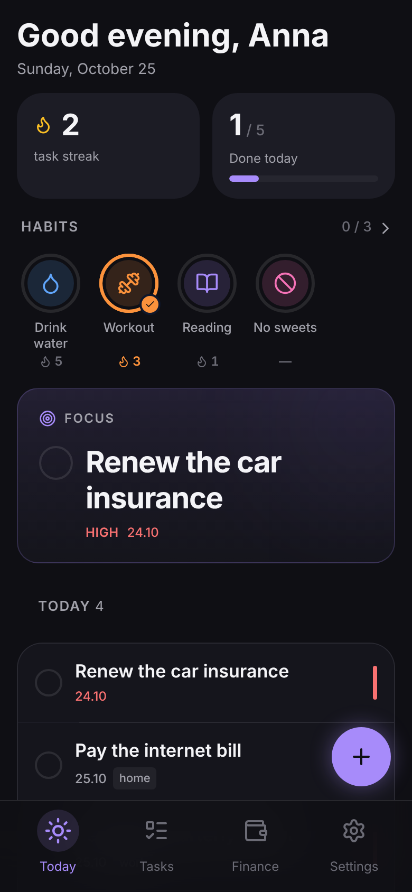
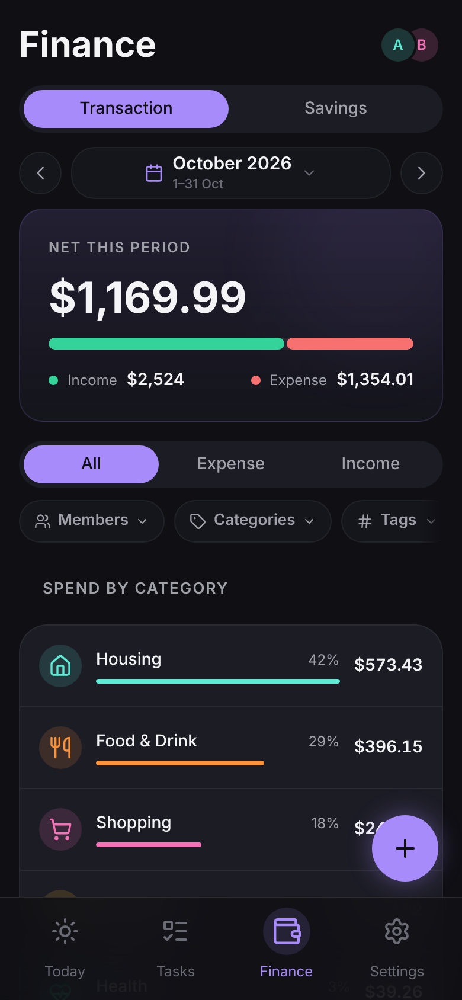
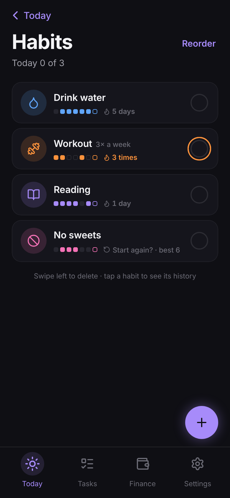
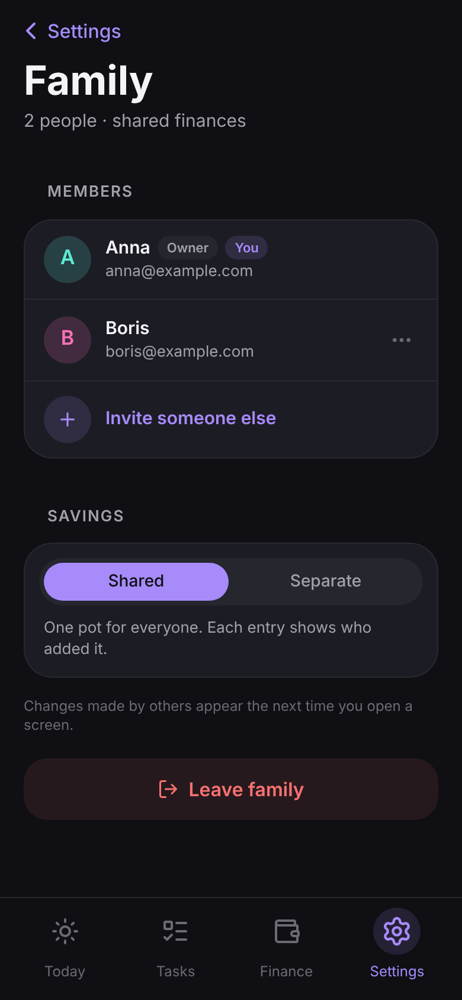

# MyDay

**Tasks, habits and a shared family budget in one app you host yourself.**

MyDay is a mobile-first web app (PWA) for a family that wants its day in one place: what to do today, which habits to keep, and where the money went — together, on your own server. One technical person sets it up with a single command; everyone else installs it on their phone's home screen and never sees the server.

[Русская версия](README.ru.md)

<p align="center">
  
  
  
  
</p>

## What it does

- **Today** — greeting, a focus task, today's and overdue tasks, habit rings you tick with one tap.
- **Tasks** — priorities, due dates, tags, templates for recurring chores, undo and a 30-day trash.
- **Habits** — daily or a few times a week, streaks, a month calendar, catch up on any of the last 7 days.
- **Family budget** — income and expenses shared by the whole family, each entry shows who added it; categories, tags, any period, filters by member, category and tag.
- **Savings and goals** — a shared or personal pot, goals with a deadline and "save X a month".
- **Privacy mode** — one tap hides every amount when someone looks over your shoulder.
- **Works offline** — add an expense without signal, it's sent once you're back online, never twice.
- **Your currency** — one currency per family, formatted the way your language writes it.
- **Bring your history** — import CSV from Zenmoney, CoinKeeper or any table; export any period back to CSV.
- **English and Russian**, dark and light theme, installs on iPhone and Android.

What it deliberately doesn't do: bank sync, currency conversion, receipts and attachments. Your data stays on your server; you can export it at any time.

## Quick start

You need a server with Docker (a VPS, a mini PC or a Raspberry Pi 4/5 — images are built for amd64 and arm64) and a domain pointing to it. HTTPS is not optional: phones only install the app and keep you signed in over HTTPS. The bundled Caddy gets a certificate for you.

```bash
mkdir myday && cd myday
curl -fsSLO https://raw.githubusercontent.com/woB2K/Nuxt-MyDay/main/docker-compose.yml
curl -fsSL https://raw.githubusercontent.com/woB2K/Nuxt-MyDay/main/scripts/selfhost/init-env.sh | sh -s -- myday.example.com
docker compose up -d
```

`init-env.sh` writes a `.env` with fresh random secrets. Open `https://myday.example.com`, create the first account — it becomes the family owner — and invite the others from **Settings → Family**. Registration is closed to everyone else: only the first account and people with an invite link can sign up.

Then install it on each phone: Safari → Share → **Add to Home Screen** on iPhone, the **Install** prompt on Android. The app explains this itself in Settings.

### Behind your own reverse proxy

Already running nginx, Traefik or Caddy? Skip the bundled one:

```bash
curl -fsSL https://raw.githubusercontent.com/woB2K/Nuxt-MyDay/main/scripts/selfhost/init-env.sh | sh -s -- https://myday.example.com --no-caddy
docker compose up -d
```

The app listens on `127.0.0.1:3000`. Proxy your domain to it, for example with nginx:

```nginx
location / {
    proxy_pass http://127.0.0.1:3000;
    proxy_set_header Host $host;
    proxy_set_header X-Forwarded-For $proxy_add_x_forwarded_for;
    proxy_set_header X-Forwarded-Proto $scheme;
}
```

Sign-in attempts are rate-limited by client address, so tell the app how many proxies stand in front of it: `NUXT_PROXY_HOPS=1` for one proxy (the default), `2` for Cloudflare → nginx, or set `NUXT_CLIENT_IP_HEADER=cf-connecting-ip`.

## Updating

```bash
docker compose pull && docker compose up -d
```

Database migrations run by themselves on every start. To stay on a version, set `MYDAY_VERSION=2.3.0` in `.env`; what changed is listed in **Settings → What's new** and on the GitHub releases page.

## Backups

Your family's finances live in the `pgdata` Docker volume. The simplest backup is a dump you copy somewhere else:

```bash
docker compose exec db pg_dump -U myday myday > myday-$(date +%F).sql
```

For nightly encrypted backups to Google Drive with rotation and health pings, turn on the `backup` profile: add it to `COMPOSE_PROFILES` in `.env` (`COMPOSE_PROFILES=caddy,backup`) and fill in the `BACKUP_*` variables. Setup and restore are described in [pg-backup](https://github.com/woB2K/pg-backup).

## Administration

There is no email, so a forgotten password is reset on the server:

```bash
docker compose run --rm migrate pnpm admin reset-password anna@example.com   # prints a new password
docker compose run --rm migrate pnpm admin users                             # list accounts
```

The reset also signs the account out on every device. The **Forgot password?** link in the app shows this command to whoever forgot.

## Configuration

Everything is set in `.env` next to `docker-compose.yml`:

| Variable | Default | What it does |
|---|---|---|
| `NUXT_PUBLIC_APP_URL` | — | Public address, used in invite links |
| `MYDAY_DOMAIN` | — | Domain for the bundled Caddy |
| `COMPOSE_PROFILES` | `caddy` | `caddy` for HTTPS, `backup` for nightly backups |
| `ALLOW_REGISTRATION` | `false` | `true` lets anyone sign up; with `false` only the first account and invited people can |
| `MYDAY_VERSION` | `latest` | Image version |
| `POSTGRES_PASSWORD`, `NUXT_JWT_ACCESS_SECRET`, `NUXT_JWT_REFRESH_SECRET` | generated | Secrets, created by `init-env.sh` |
| `NUXT_PROXY_HOPS`, `NUXT_CLIENT_IP_HEADER` | `1`, empty | How to find the client address behind proxies |
| `APP_BIND`, `APP_PORT` | `127.0.0.1`, `3000` | Where the app listens on the host |

## Moving from another app

**Settings → Import from CSV** takes an export from Zenmoney or CoinKeeper, or any table with `date` and `amount` columns (plus `type`, `category`, `tags`, `notes` if you have them). You see the period, the number of transactions and the categories before anything is saved, can match unknown categories with yours, and importing the same file twice adds nothing. Transfers between accounts are skipped.

## Demo

Want to look around first? In a folder prepared as in the quick start, download `docker-compose.demo.yml` next to `docker-compose.yml` and run the demo with a ready family and three months of history:

```bash
docker compose -f docker-compose.yml -f docker-compose.demo.yml up -d
```

The welcome screen gets a **Try the demo** button. The demo resets every 24 hours (`DEMO_LANG=en` for an English family in dollars), and the PIN lock and family changes are turned off so one visitor can't spoil it for the next.

## Development

MyDay is built with Nuxt 4, Vue 3, Prisma 7 and PostgreSQL. See [CONTRIBUTING.md](CONTRIBUTING.md) for the local setup, tests and conventions, and [ARCHITECTURE.md](ARCHITECTURE.md) for how and why things are built the way they are. Security issues go through [SECURITY.md](SECURITY.md).

## License

[AGPL-3.0](LICENSE). You can run, change and share MyDay freely; if you offer a modified version to others over a network, you share your changes under the same license.
