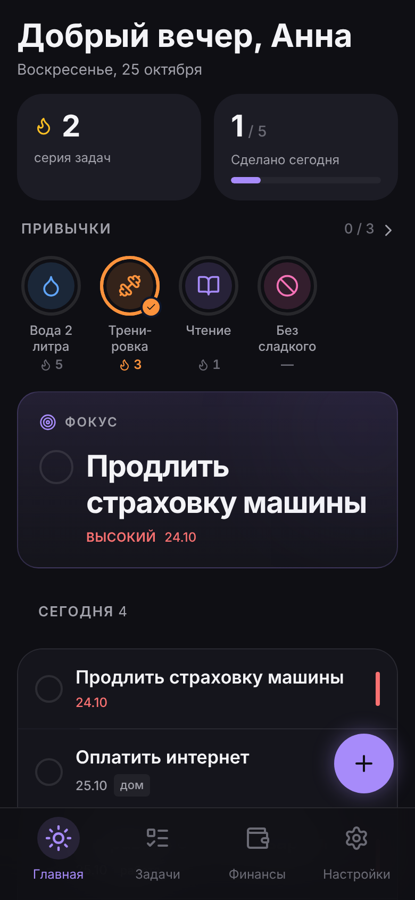
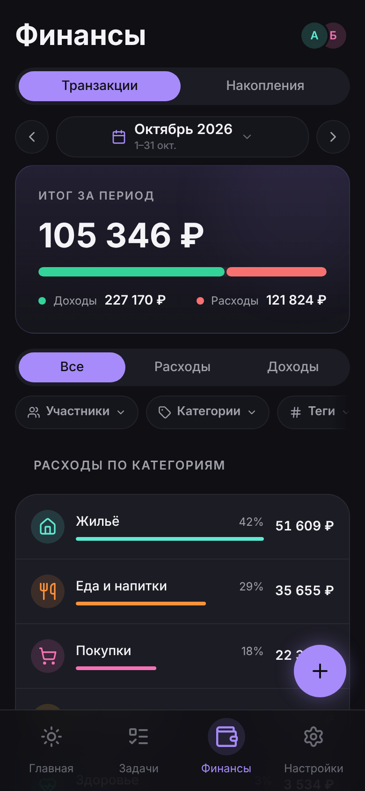
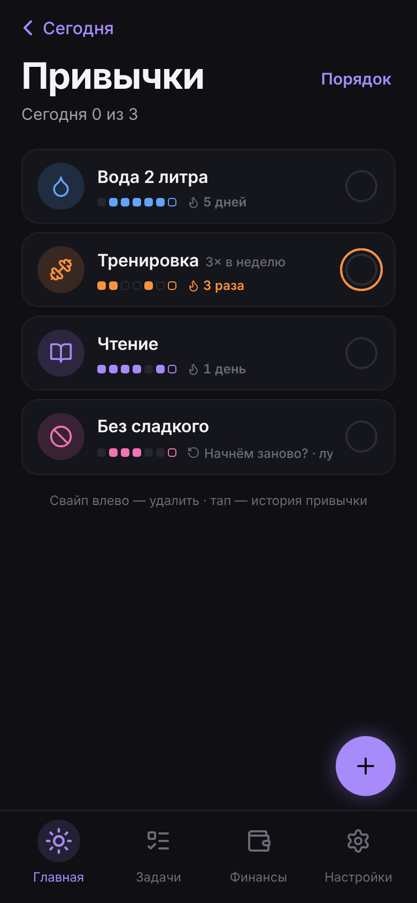
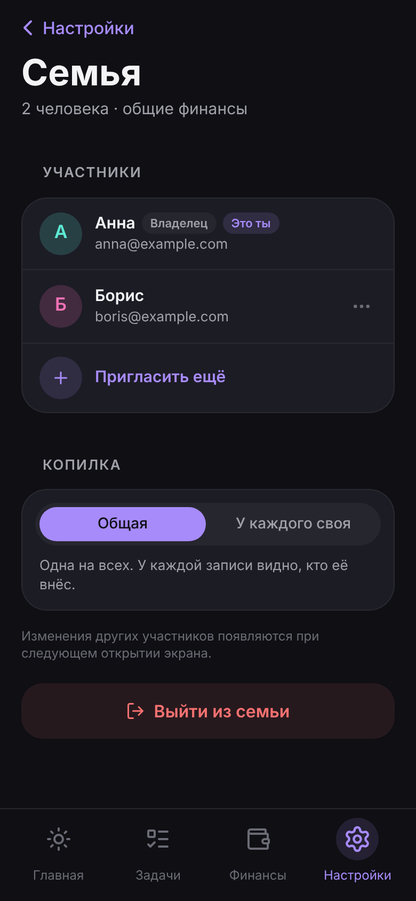

# MyDay

**Задачи, привычки и общий бюджет семьи в одном приложении на вашем сервере.**

MyDay — мобильное веб-приложение (PWA) для семьи, которая хочет держать свой день в одном месте: что сделать сегодня, какие привычки не бросать и куда ушли деньги — вместе и на своём сервере. Один технарь в семье поднимает его одной командой, остальные ставят иконку на экран телефона и сервера не видят.

[English version](README.md)

<p align="center">
  
  
  
  
</p>

## Что умеет

- **Сегодня** — приветствие, задача в фокусе, задачи на сегодня и просроченные, кольца привычек отмечаются одним тапом.
- **Задачи** — приоритеты, сроки, теги, шаблоны для повторяющихся дел, «Отменить» и корзина на 30 дней.
- **Привычки** — каждый день или несколько раз в неделю, серии, календарь за месяц, отметка задним числом за последние 7 дней.
- **Семейный бюджет** — доходы и расходы общие на всю семью, у каждой записи виден автор; категории, теги, любой период, фильтры по участнику, категории и тегу.
- **Копилка и цели** — общая или у каждого своя, цели со сроком и «откладывать X в месяц».
- **Режим приватности** — один тап прячет все суммы, когда кто-то смотрит через плечо.
- **Работает без сети** — трату можно записать без связи, она уйдёт, когда сеть вернётся, и ни разу не задвоится.
- **Своя валюта** — одна на семью, суммы пишутся так, как принято в вашем языке.
- **История не теряется** — импорт CSV из Дзен-мани, CoinKeeper или любой таблицы, выгрузка любого периода обратно в CSV.
- **Русский и английский**, тёмная и светлая тема, ставится на iPhone и Android.

Чего сознательно нет: синхронизации с банками, пересчёта валют, чеков и вложений. Данные лежат на вашем сервере, выгрузить их можно в любой момент.

## Быстрый старт

Нужен сервер с Docker (VPS, мини-ПК или Raspberry Pi 4/5 — образы собраны под amd64 и arm64) и домен, который на него смотрит. HTTPS обязателен: только по HTTPS телефон установит приложение и не будет выкидывать из аккаунта. Встроенный Caddy сам получит сертификат.

```bash
mkdir myday && cd myday
curl -fsSLO https://raw.githubusercontent.com/woB2K/Nuxt-MyDay/main/docker-compose.yml
curl -fsSL https://raw.githubusercontent.com/woB2K/Nuxt-MyDay/main/scripts/selfhost/init-env.sh | sh -s -- myday.example.com
docker compose up -d
```

`init-env.sh` пишет `.env` со свежими случайными секретами. Откройте `https://myday.example.com` и создайте первый аккаунт — он станет владельцем семьи. Остальных пригласите в **Настройки → Семья**. Для всех прочих регистрация закрыта: зарегистрироваться могут только первый аккаунт и люди со ссылкой-приглашением.

Потом поставьте приложение на каждый телефон: на iPhone — Safari → «Поделиться» → **«На экран „Домой“»**, на Android — кнопка **«Установить»**. В настройках приложение само это объясняет.

### За своим reverse proxy

Уже стоит nginx, Traefik или Caddy? Встроенный не нужен:

```bash
curl -fsSL https://raw.githubusercontent.com/woB2K/Nuxt-MyDay/main/scripts/selfhost/init-env.sh | sh -s -- https://myday.example.com --no-caddy
docker compose up -d
```

Приложение слушает `127.0.0.1:3000`. Проксируйте на него свой домен, например nginx:

```nginx
location / {
    proxy_pass http://127.0.0.1:3000;
    proxy_set_header Host $host;
    proxy_set_header X-Forwarded-For $proxy_add_x_forwarded_for;
    proxy_set_header X-Forwarded-Proto $scheme;
}
```

Попытки входа ограничены по адресу клиента, поэтому скажите приложению, сколько прокси стоит перед ним: `NUXT_PROXY_HOPS=1` для одного (по умолчанию), `2` для Cloudflare → nginx, или задайте `NUXT_CLIENT_IP_HEADER=cf-connecting-ip`.

## Обновление

```bash
docker compose pull && docker compose up -d
```

Миграции базы применяются сами при каждом запуске. Чтобы остаться на конкретной версии, задайте `MYDAY_VERSION=2.3.0` в `.env`. Что изменилось — в **Настройки → Что нового** и на странице релизов GitHub.

## Бэкапы

Финансы семьи лежат в Docker-томе `pgdata`. Самый простой бэкап — дамп, который вы уносите в другое место:

```bash
docker compose exec db pg_dump -U myday myday > myday-$(date +%F).sql
```

Для ночных зашифрованных бэкапов в Google Drive с ротацией и пингами о здоровье включите профиль `backup`: добавьте его в `COMPOSE_PROFILES` в `.env` (`COMPOSE_PROFILES=caddy,backup`) и заполните переменные `BACKUP_*`. Настройка и восстановление описаны в [pg-backup](https://github.com/woB2K/pg-backup).

## Администрирование

Почты нет, поэтому забытый пароль сбрасывается на сервере:

```bash
docker compose run --rm migrate pnpm admin reset-password anna@example.com   # выведет новый пароль
docker compose run --rm migrate pnpm admin users                             # список аккаунтов
```

Сброс заодно выводит аккаунт на всех устройствах. Ссылка **«Забыли пароль?»** в приложении показывает эту команду тому, кто забыл.

## Настройки

Всё задаётся в `.env` рядом с `docker-compose.yml`:

| Переменная | По умолчанию | Что делает |
|---|---|---|
| `NUXT_PUBLIC_APP_URL` | — | Публичный адрес, на нём строятся ссылки-приглашения |
| `MYDAY_DOMAIN` | — | Домен для встроенного Caddy |
| `COMPOSE_PROFILES` | `caddy` | `caddy` — HTTPS, `backup` — ночные бэкапы |
| `ALLOW_REGISTRATION` | `false` | `true` — регистрироваться может кто угодно; при `false` — только первый аккаунт и приглашённые |
| `MYDAY_VERSION` | `latest` | Версия образов |
| `POSTGRES_PASSWORD`, `NUXT_JWT_ACCESS_SECRET`, `NUXT_JWT_REFRESH_SECRET` | генерируются | Секреты, их создаёт `init-env.sh` |
| `NUXT_PROXY_HOPS`, `NUXT_CLIENT_IP_HEADER` | `1`, пусто | Как найти адрес клиента за прокси |
| `APP_BIND`, `APP_PORT` | `127.0.0.1`, `3000` | Где приложение слушает на хосте |

## Переезд из другого приложения

**Настройки → Импорт из CSV** принимает выгрузку из Дзен-мани или CoinKeeper либо любую таблицу с колонками `date` и `amount` (и `type`, `category`, `tags`, `notes`, если есть). До сохранения видно период, число операций и категории, незнакомые категории можно сопоставить со своими, а повторный импорт того же файла ничего не задвоит. Переводы между счетами пропускаются.

## Демо

Хотите сначала посмотреть? В папке, подготовленной как в быстром старте, положите `docker-compose.demo.yml` рядом с `docker-compose.yml` и поднимите демо с готовой семьёй и историей за три месяца:

```bash
docker compose -f docker-compose.yml -f docker-compose.demo.yml up -d
```

На стартовом экране появится кнопка **«Посмотреть демо»**. Демо сбрасывается раз в сутки (`DEMO_LANG=en` — английская семья в долларах), а PIN-блокировка и изменения семьи в нём отключены, чтобы один посетитель не испортил его следующему.

## Разработка

MyDay написан на Nuxt 4, Vue 3, Prisma 7 и PostgreSQL. Локальный запуск, тесты и соглашения — в [CONTRIBUTING.md](CONTRIBUTING.md), как и почему всё устроено — в [ARCHITECTURE.md](ARCHITECTURE.md). Уязвимости — через [SECURITY.md](SECURITY.md).

## Лицензия

[AGPL-3.0](LICENSE). MyDay можно свободно запускать, менять и распространять; если вы даёте другим доступ к изменённой версии по сети, вы делитесь своими изменениями под той же лицензией.
